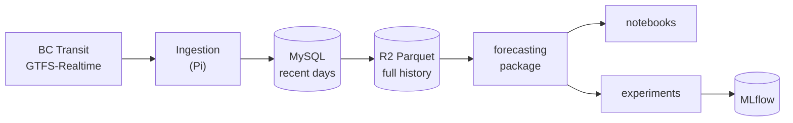

# Transit Forecasting

Bus delay forecasting for BC Transit in Kelowna, built on our own archive of
its GTFS-Realtime feed.

A Raspberry Pi records the feed every 5 seconds and archives each day to
Cloudflare R2. The `forecasting` package turns that history into analyses and
models. Research studies test whether those models predict arrival delays
better than BC Transit's own published estimates. The first study,
[hwy97_delay](experiments/hwy97_delay/RESEARCH.md), covers Route 97 along
Highway 97.



See [docs/architecture.md](docs/architecture.md) for the full picture.

## Repository layout

| Directory | Contents |
|-----------|----------|
| [data_ingestion/](data_ingestion) | GTFS-Realtime ingestion service, MySQL storage and the nightly R2 archive ([README](data_ingestion/README.md)) |
| [forecasting/](forecasting) | `forecasting` package: data loading, congestion and delay analyses, models and the study harness ([README](forecasting/README.md)) |
| [notebooks/](notebooks) | Analysis notebooks ([notebook guide](notebooks/README.md)) |
| [experiments/](experiments) | Research studies: charter, log and evaluation harness |
| [docs/](docs) | Architecture, data reference, operations and analysis docs ([index](docs/README.md)) |
| `data/` | Local snapshots, generated outputs and the MLflow store (ignored by Git) |

## Documentation

| If you want to… | Read |
|---|---|
| Understand how the pieces fit | [Architecture](docs/architecture.md) |
| Know what a column means or why a number looks wrong | [GTFS-Realtime data reference](docs/gtfs-rt-data.md) |
| Load historical data into a notebook | [Historical backtest data](docs/backtest-data.md) |
| Deploy to or fix the Pi | [Operations runbook](docs/operations.md) |
| Pick a notebook to read | [Notebook guide](notebooks/README.md) |
| See how research studies are run | [Agent research loop](docs/agent-research-loop.md) |
| Browse every doc | [Docs index](docs/README.md) |

## Development setup

### Python environment

Use your preferred environment manager. With conda:

```bash
conda create -n transit_env python=3.11
conda activate transit_env
pip install -r requirements.txt                   # both packages (editable), Jupyter, pre-commit
pip install -e "./forecasting[tracking]"          # MLflow, for study runs
```

Run both commands from the repository root.

Keep the environment's `tzdata` current. British Columbia has been on UTC−7
all year since 2026-03-08, and an older timezone database converts local times
wrongly from 2026-11-01 onwards
([issue #13](https://github.com/AbdulRahmanSilmy/transit-forecasting/issues/13)).

### Tests

Each package has its own tests. Run them from the package directory, because
running from the repository root fails on imports:

```bash
cd forecasting      # or data_ingestion
conda run -n transit_env python -m pytest tests/unit -q
```

The MySQL integration tests run in Docker; see the
[data_ingestion README](data_ingestion/README.md#tests).

### Pre-commit hooks

```bash
pre-commit install
```

The hooks run black, isort, ruff and basic whitespace and YAML checks.

### Contributing

- Commit messages start with a type prefix (`Add:`, `Fix:`, `Refactor:`,
  `Test:`, `Docs:`, `Chore:`, `Revert:`); see [AGENTS.md](AGENTS.md).
- Work items are GitHub issues. Use the issue templates: experiment, decision,
  or ops and bug.
- Research study rules (frozen harness, locked test period, logging every
  run) are in [AGENTS.md](AGENTS.md#research-loop).

## Viewing experiment results (MLflow)

Research harness runs (for example
[experiments/hwy97_delay/evaluate.py](experiments/hwy97_delay/evaluate.py)) log
metrics, parameters and figures to a local MLflow store in `data/mlflow/`
(SQLite `mlflow.db` plus `artifacts/`, ignored by Git). Start the MLflow UI
from the repository root:

```bash
conda run --no-capture-output -n transit_env mlflow ui \
  --backend-store-uri sqlite:///data/mlflow/mlflow.db
```

Then open http://127.0.0.1:5000 and pick the study's experiment (such as
`hwy97_delay`). Add `--port <port>` if 5000 is already in use. Stop the server
with `Ctrl+C`.

In VS Code, the **MLflow UI** task in [.vscode/tasks.json](.vscode/tasks.json)
runs this automatically when the folder opens. Allow it once via
*Tasks: Manage Automatic Tasks* → *Allow Automatic Tasks*. It assumes the
`transit_env` environment lives at `~/miniconda3/envs/transit_env` and skips
starting if port 5000 is already taken. Run it manually with
*Tasks: Run Task* → *MLflow UI*, and stop it by closing its terminal.

The store only exists after at least one harness run. Each study's `LOG.md`
cites the MLflow run ID for every logged result, and its `HARNESS.md` lists
what each run records.

## Data ingestion

The ingestion service, its configuration, the R2 archive and MySQL retention
are documented in the [data_ingestion README](data_ingestion/README.md).
Running it on the Pi is covered in the
[operations runbook](docs/operations.md).
