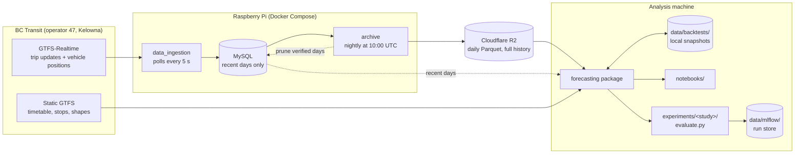

# Architecture

How data moves from BC Transit's realtime feed to a scored forecast, and
where each piece lives.

## Components

| Component | Code | Runs on | Docs |
|---|---|---|---|
| Ingestion service | [data_ingestion/](../data_ingestion) (`python -m data_ingestion`) | Pi, container `data_ingestion` | [data_ingestion README](../data_ingestion/README.md) |
| MySQL store | [sql/](../data_ingestion/data_ingestion/sql) templates | Pi, container `transit_mysql` | [Data reference](gtfs-rt-data.md) |
| Nightly archive and retention | `data_ingestion.nightly`, `.archive`, `.retention` | Pi, container `transit_archive` | [data_ingestion README](../data_ingestion/README.md#archive-to-cloudflare-r2), [operations](operations.md) |
| Parquet archive | `r2://<bucket>/archive/<table>/date=YYYY-MM-DD/data.parquet` | Cloudflare R2 | [Backtest data](backtest-data.md#r2-archive-default-for-notebooks) |
| Data access | `forecasting.backtest_data`, `r2_archive`, `static_gtfs` | Analysis machine | [Backtest data](backtest-data.md) |
| Analyses and models | [forecasting/](../forecasting) | Analysis machine | [forecasting README](../forecasting/README.md), [docs index](README.md) |
| Research studies | [experiments/](../experiments) | Analysis machine | [Agent research loop](agent-research-loop.md) |
| Run store | local MLflow, `data/mlflow/` | Analysis machine | [README](../README.md#viewing-experiment-results-mlflow) |

## Data flow

1. **Capture.** Two threads in the ingestion service poll the trip-update and
   vehicle-position feeds every 5 seconds. Each thread writes a row only when an
   entity has changed since it was last seen (see
   [what a row is](gtfs-rt-data.md#what-a-row-is)). That is about 1.4 million
   trip-update rows and 130 thousand vehicle rows a day.
2. **Short-term storage.** MySQL on the Pi holds the newest days. The SD card
   cannot hold the full history, which is about 200 MB a day in MySQL.
3. **Archive.** Every night the `archive` service copies each complete UTC day
   that is not yet in R2 to one zstd Parquet file per table, about 14 MB a day.
   It checks every upload's row count against MySQL. When
   `ARCHIVE_RETAIN_DAYS` is set, it then deletes older days from MySQL, but
   only days whose R2 copy exists and matches.
4. **Load.** `get_backtest_dataset(source="r2")` reads a window from R2,
   downloads the current static GTFS and saves both as a local snapshot under
   `data/backtests/`. Later calls with the same `dataset_id` replay the snapshot
   offline. `source="download"` reads straight from MySQL on the Pi, for days
   not yet in R2.
5. **Analyse.** Notebooks call `forecasting` functions for EDA, congestion
   maps and exploratory models.
6. **Evaluate.** A study's frozen harness (for example
   [experiments/hwy97_delay/evaluate.py](../experiments/hwy97_delay/evaluate.py))
   loads a snapshot, fits candidates on development folds, scores them against
   a baseline ladder and logs each run to MLflow. The study's `LOG.md` records
   the reasoning and cites the run ID.

## Where things are kept

| What | Where | In Git? |
|---|---|---|
| Code, docs, study charters and logs | this repository | yes |
| Recent realtime rows | MySQL volume `mysql_data` on the Pi | no |
| Full realtime history | Cloudflare R2 bucket | no |
| Snapshots, generated outputs, MLflow store | `data/` | no (ignored) |
| Secrets (MySQL passwords, R2 keys) | `data_ingestion/.env` on the Pi; repository `.env` on the analysis machine | no (ignored) |
| Work queue and decisions | GitHub issues and the [project board](https://github.com/users/AbdulRahmanSilmy/projects/3) | no |

## Design choices

- **Store the feed as published.** Ingestion does not convert time zones or
  clean values. Event times are stored as UTC and the trip start descriptor as
  the agency's local text. Corrections and exclusions belong in analysis code,
  where they can be tested and changed.
- **Parquet in R2 instead of a bigger database.** It is cheap, needs no server,
  and can be queried with DuckDB. Files are sorted by route and direction in
  small row groups, so reading one route downloads only part of each file.
- **Verify before deleting.** Retention removes a MySQL day only after its R2
  copy has been checked, and compaction refuses to run if any older day is
  unverified.
- **Frozen harness, free candidates.** The evaluation code for a study is
  protected so scores stay comparable across runs. Model code is open to
  change. See [agent-research-loop.md](agent-research-loop.md).
