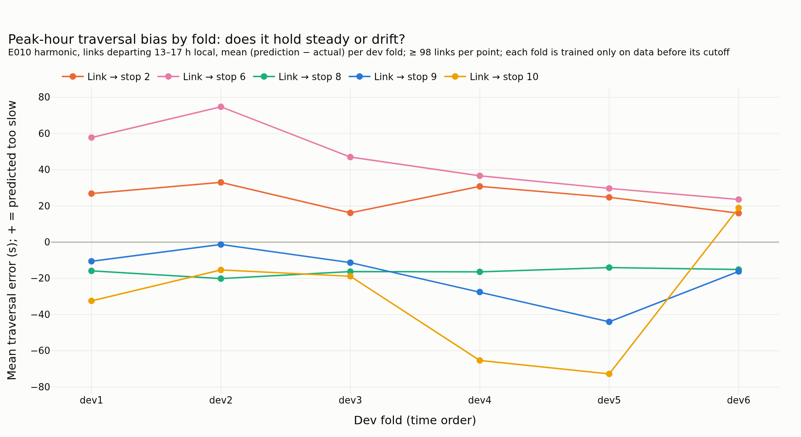
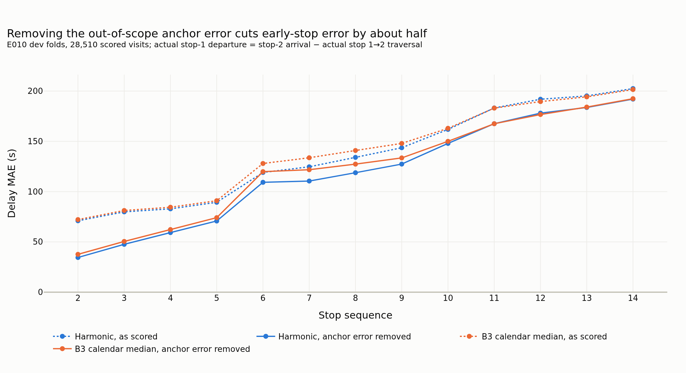
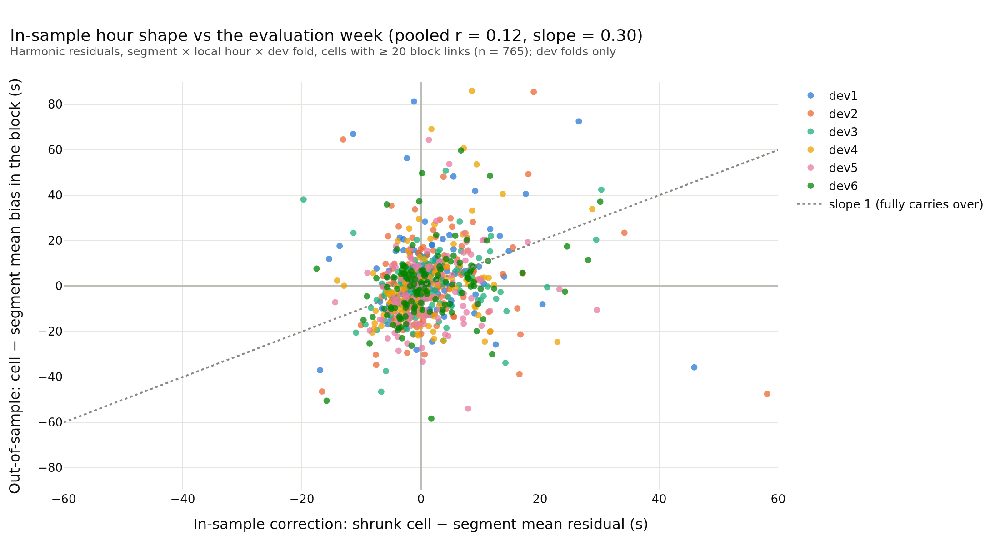
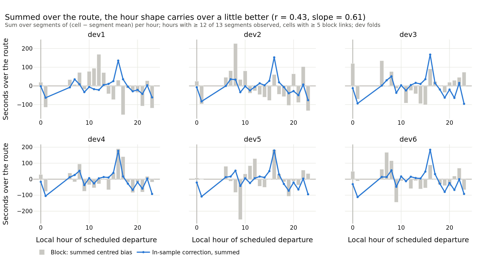
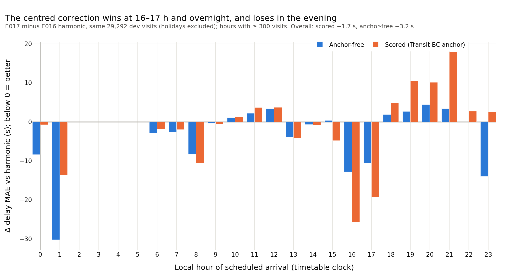
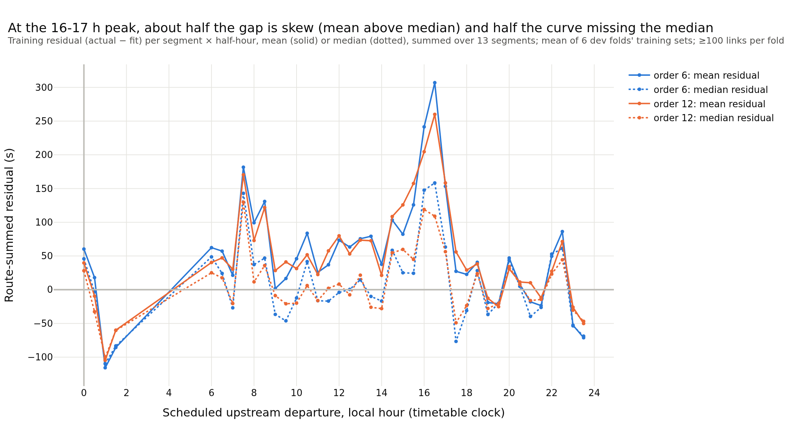
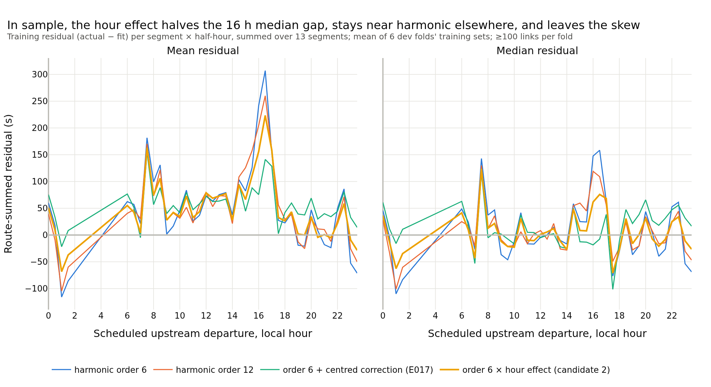
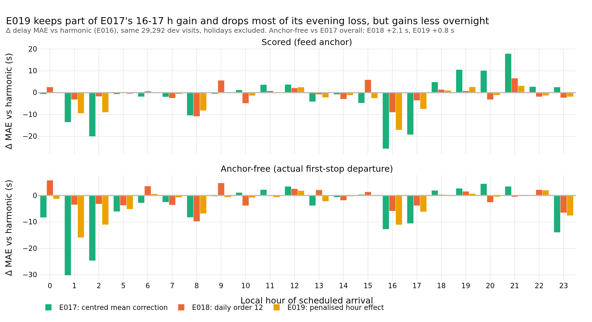

# Experiment log: Hwy 97 delay forecasting

Append-only. One entry per run, including failed and negative results. Each entry must be reproducible from its git hash, and cites its **MLflow run ID** (local store `data/mlflow/`, experiment `hwy97_delay`; see HARNESS.md). MLflow holds the numbers, figures and predictions. This log holds the reasoning.

Scores are **development folds only** unless the entry is marked `LOCKED TEST` (owner-approved, at most once per candidate).

Links: issue numbers open the GitHub issue, whose **Experiment runs** section links back to its entries here. Git hashes open the commit on GitHub. MLflow run IDs open the run in the local MLflow UI, so start it first from the repo root: `conda run -n transit_env mlflow ui --backend-store-uri sqlite:///data/mlflow/mlflow.db`.

## Summary table

| ID | Date | Git | Hypothesis (issue) | Change | MAE (s) | Δ vs B0 [95% CI] | Δ vs best baseline | Verdict |
|---|---|---|---|---|---|---|---|---|
| E000 | 2026-11-19 | [56c993e](https://github.com/AbdulRahmanSilmy/transit-forecasting/commit/56c993e) | prior evidence | Segment 4 notebook, not run under the harness | see below | n/a | n/a | context |
| E001 | 2026-11-20 | [bb769cf](https://github.com/AbdulRahmanSilmy/transit-forecasting/commit/bb769cf) | H0 | dev: harmonic_huber ([7741d709320c49ae9da47ce907853ecd](http://127.0.0.1:5000/#/experiments/1/runs/7741d709320c49ae9da47ce907853ecd)) | 139.0 (B0 166.2) | -27.2 [-36.0, -18.6] (-16.4%) | -4.2 vs B3_calendar_median | provisional baseline |
| E002 | 2026-11-20 | [64f51eb](https://github.com/AbdulRahmanSilmy/transit-forecasting/commit/64f51eb) | H1 ([#13](https://github.com/AbdulRahmanSilmy/transit-forecasting/issues/13)) | dev: harmonic_huber ([f38bff5b31864f3497745333592f9ee2](http://127.0.0.1:5000/#/experiments/1/runs/f38bff5b31864f3497745333592f9ee2)) | 134.4 (B0 166.1) | -31.7 [-38.8, -24.7] (-19.1%) | -2.6 vs B3_calendar_median | H1 confirmed; superseded by E003 |
| E003 | 2026-11-20 | [5d9cfa5](https://github.com/AbdulRahmanSilmy/transit-forecasting/commit/5d9cfa5) | H1 ([#13](https://github.com/AbdulRahmanSilmy/transit-forecasting/issues/13)) | dev: harmonic_huber ([98ca4b712d70439eaf1fde2a555d32fe](http://127.0.0.1:5000/#/experiments/1/runs/98ca4b712d70439eaf1fde2a555d32fe)) | 134.5 (B0 166.2) | -31.7 [-38.8, -24.7] (-19.1%) | -2.5 vs B3_calendar_median | keep; current baseline |
| E004 | 2026-11-20 | [1fe6300](https://github.com/AbdulRahmanSilmy/transit-forecasting/commit/1fe6300) | H0 (evidence for H7, [#15](https://github.com/AbdulRahmanSilmy/transit-forecasting/issues/15)) | dev: harmonic_huber + traversal diagnostics ([a9a38c98ebe3421e8d0f8562c594fef5](http://127.0.0.1:5000/#/experiments/1/runs/a9a38c98ebe3421e8d0f8562c594fef5)) | 134.5 (B0 166.2) | -31.7 [-38.8, -24.7] (-19.1%) | -2.5 vs B3_calendar_median | diagnostic; see H7 |
| E005 | 2026-11-21 | [2ba991b](https://github.com/AbdulRahmanSilmy/transit-forecasting/commit/2ba991b) | H4 ([#17](https://github.com/AbdulRahmanSilmy/transit-forecasting/issues/17)) | dev: pooled_harmonic ([60dd6de41dd34ac1835385a63a510b98](http://127.0.0.1:5000/#/experiments/1/runs/60dd6de41dd34ac1835385a63a510b98)) | 165.1 (B0 166.2) | -1.0 [-7.3, +4.4] (-0.6%) | +28.1 vs B3_calendar_median | discard |
| E006 | 2026-11-21 | [714ceff](https://github.com/AbdulRahmanSilmy/transit-forecasting/commit/714ceff) | H4 ([#17](https://github.com/AbdulRahmanSilmy/transit-forecasting/issues/17)) | dev: pooled_harmonic_partial ([f4dabda4739742f99091f28fc7051fed](http://127.0.0.1:5000/#/experiments/1/runs/f4dabda4739742f99091f28fc7051fed)) | 146.4 (B0 166.2) | -19.8 [-25.5, -14.1] (-11.9%) | +9.4 vs B3_calendar_median | discard; H4 refuted |
| E007 | 2026-11-21 | [98ddf13](https://github.com/AbdulRahmanSilmy/transit-forecasting/commit/98ddf13) | H3 ([#18](https://github.com/AbdulRahmanSilmy/transit-forecasting/issues/18)) | dev: harmonic_recent_level ([b57247076a5a43e2a2ad5ebf8d14b4d3](http://127.0.0.1:5000/#/experiments/1/runs/b57247076a5a43e2a2ad5ebf8d14b4d3)) | 138.5 (B0 166.2) | -27.6 [-35.2, -20.1] (-16.6%) | +1.5 vs B3_calendar_median | discard; H3 refuted at this history length |
| E008 | 2026-11-22 | [7e8ec57](https://github.com/AbdulRahmanSilmy/transit-forecasting/commit/7e8ec57) | [#21](https://github.com/AbdulRahmanSilmy/transit-forecasting/issues/21) | dev: harmonic_huber ([9e031ab3b21441eb9a4bc84b5cb3a5fa](http://127.0.0.1:5000/#/experiments/1/runs/9e031ab3b21441eb9a4bc84b5cb3a5fa)) | 134.6 (B0 166.3) | -31.7 [-38.9, -24.8] (-19.1%) | -2.5 vs B3_calendar_median | keep; untracked journeys excluded, baseline unchanged |
| E009 | 2026-11-22 | [b838ef7](https://github.com/AbdulRahmanSilmy/transit-forecasting/commit/b838ef7) | H6 ([#14](https://github.com/AbdulRahmanSilmy/transit-forecasting/issues/14)) | dev: harmonic_huber + calendar_median anchor ([17781bc9f5d145fe93d8558d478515ee](http://127.0.0.1:5000/#/experiments/1/runs/17781bc9f5d145fe93d8558d478515ee)) | 136.3 (B0 166.3) | -30.0 [-38.0, -21.9] (-18.0%) | -4.6 vs B3_calendar_median | discard; bias removed (+2.8 s) but MAE +1.7 vs E008 |
| E010 | 2026-11-22 | [7980583](https://github.com/AbdulRahmanSilmy/transit-forecasting/commit/7980583) | [#12](https://github.com/AbdulRahmanSilmy/transit-forecasting/issues/12) | dev: harmonic_huber ([20ccac3e2f11424598521a00fc921fe5](http://127.0.0.1:5000/#/experiments/1/runs/20ccac3e2f11424598521a00fc921fe5)) | 134.6 (B0 166.3) | -31.7 [-38.8, -25.0] (-19.1%) | -1.8 vs B3_calendar_median | keep; stale first-stop departures train link 1 (+1,297 links), new reference baseline |
| E011 | 2026-11-22 | [650edbc](https://github.com/AbdulRahmanSilmy/transit-forecasting/commit/650edbc) | H8 ([#25](https://github.com/AbdulRahmanSilmy/transit-forecasting/issues/25)) | exploration only ([b010f8bef5fd41f986c91aa7b1584481](http://127.0.0.1:5000/#/experiments/1/runs/b010f8bef5fd41f986c91aa7b1584481)) | n/a | n/a | n/a | design and prediction registered; scored run pending |
| E012 | 2026-11-22 | [1d996ac](https://github.com/AbdulRahmanSilmy/transit-forecasting/commit/1d996ac) | [#13](https://github.com/AbdulRahmanSilmy/transit-forecasting/issues/13) | dev: harmonic_huber ([f458246392df4df39e7259c10dd71fc5](http://127.0.0.1:5000/#/experiments/1/runs/f458246392df4df39e7259c10dd71fc5)) | 134.6 (B0 166.3) | -31.7 [-38.8, -25.0] (-19.1%) | -1.8 vs B3_calendar_median | keep; #13 root cause corrected (stale tz database), scores identical to E010 |
| E013 | 2026-11-22 | [bb12d9b](https://github.com/AbdulRahmanSilmy/transit-forecasting/commit/bb12d9b) | anchor-free metric | dev: harmonic_huber ([eaec6ba932224a028e518e2fc0810ac7](http://127.0.0.1:5000/#/experiments/1/runs/eaec6ba932224a028e518e2fc0810ac7)) | 134.6 (B0 166.3; anchor-free 123.0, defective) | -31.7 [-38.8, -25.0] (-19.1%) | -1.8 vs B3_calendar_median | primary unchanged; anchor-free superseded by E014 |
| E014 | 2026-11-22 | [70483aa](https://github.com/AbdulRahmanSilmy/transit-forecasting/commit/70483aa) | anchor-free metric | dev: harmonic_huber ([ba74c30a7598434a9b385237c7b9e1c4](http://127.0.0.1:5000/#/experiments/1/runs/ba74c30a7598434a9b385237c7b9e1c4)) | 134.6 (B0 166.3; anchor-free 116.3) | -31.7 [-38.8, -25.0] (-19.1%) | -1.8 vs B3_calendar_median | keep; anchor-free reference (B3 119.7; harmonic vs B3 −3.3 [−7.7, +0.3]) |
| E015 | 2026-11-22 | [4f80b84](https://github.com/AbdulRahmanSilmy/transit-forecasting/commit/4f80b84) | H8 ([#25](https://github.com/AbdulRahmanSilmy/transit-forecasting/issues/25)) | dev: harmonic_residual_hour ([7594714fa45d41f1b95959a6347f1550](http://127.0.0.1:5000/#/experiments/1/runs/7594714fa45d41f1b95959a6347f1550)) | not interpreted (shuffled control failed) | n/a | n/a | superseded by E017 (owner chose option (c)) |
| E016 | 2026-11-27 | [62583ad](https://github.com/AbdulRahmanSilmy/transit-forecasting/commit/62583ad) | [#36](https://github.com/AbdulRahmanSilmy/transit-forecasting/issues/36) | dev: harmonic_huber, post-midnight journeys recovered ([505097b99658454c9c35757184b6d3d6](http://127.0.0.1:5000/#/experiments/1/runs/505097b99658454c9c35757184b6d3d6)) | 132.9 (B0 162.8; anchor-free 115.5) | -30.0 [-36.7, -23.6] (-18.4%) | -1.3 vs B3_calendar_median | keep; +1,550 overnight visits, new reference baseline |
| E017 | 2026-11-28 | [e1063a3](https://github.com/AbdulRahmanSilmy/transit-forecasting/commit/e1063a3) | H8 ([#25](https://github.com/AbdulRahmanSilmy/transit-forecasting/issues/25)) | dev: harmonic_residual_hour_centred ([400457c929b64472a6dbc272b635d599](http://127.0.0.1:5000/#/experiments/1/runs/400457c929b64472a6dbc272b635d599)) | 131.1 (B0 162.8; anchor-free 112.3) | -31.7 [-38.3, -25.4] (-19.5%) | -3.1 vs B3_calendar_median | keep; vs harmonic −1.7 [−2.9, −0.4] scored, −3.2 [−4.5, −1.7] anchor-free |
| E018 | 2026-11-28 | [275ddcc](https://github.com/AbdulRahmanSilmy/transit-forecasting/commit/275ddcc) | H10 ([#43](https://github.com/AbdulRahmanSilmy/transit-forecasting/issues/43)) | dev: harmonic_daily12 ([0ef31a40c53843df8f937b82d21f1604](http://127.0.0.1:5000/#/experiments/1/runs/0ef31a40c53843df8f937b82d21f1604)) | 131.8 (B0 162.8; anchor-free 114.4) | -31.0 [-37.6, -24.8] (-19.1%) | -2.4 vs B3_calendar_median | discard; vs E017 +0.7 [−0.6, +1.9] scored, +2.1 [+0.7, +3.4] anchor-free |
| E019 | 2026-11-28 | [275ddcc](https://github.com/AbdulRahmanSilmy/transit-forecasting/commit/275ddcc) | H10 ([#43](https://github.com/AbdulRahmanSilmy/transit-forecasting/issues/43)) | dev: harmonic_hour_effect ([02b0b5992a18431c804872ae5c96b74f](http://127.0.0.1:5000/#/experiments/1/runs/02b0b5992a18431c804872ae5c96b74f)) | 130.4 (B0 162.8; anchor-free 113.1) | -32.4 [-38.9, -26.1] (-19.9%) | -3.8 vs B3_calendar_median | discard vs E017 (anchor-free +0.8 [+0.05, +1.5]); scored −0.7 [−1.3, −0.1], evening loss mostly gone |

## Entries

### E000: prior evidence (segment 4 harmonic notebook)

- Scope: one segment, traversal time (not delay), reserved week Nov 3–9, 391 visits. This week was already seen during EDA, so the result is exploratory.
- **Training period (in-sample):** the harmonic model beat Transit BC's earliest-feed traversal at capturing recurring traffic, particularly the **early-day/morning peak, which Transit BC under-predicts**. This is a fit diagnostic, not held-out skill.
- **Holdout (Nov 3–9, after Nov 1):** the **morning peak appears shifted** relative to the learned pattern, which degraded the harmonic model's performance:
  - Traversal MAE: early-feed implied (Transit BC) 1.022 min, harmonic Huber-Lasso 1.248 min, global training median 1.133 min.
  - Per visit: Transit BC had the lower error on 212 visits, harmonic on 179.
  - Observed daily medians sat below the fitted pattern after Nov 1.
- The shift coincides with the DST change on Sun 2026-11-01. A timezone (phase) bug vs a genuine timing/level change is untested: backlog H1.
- Implication: there is a recurring morning peak Transit BC misses, which supports the study. But the pattern must survive changes like Nov 1, and the B2/B3 medians are serious competitors.

### E001: harness baseline (H0), 2-month window

- Hypothesis: H0, i.e. build the harness and reproduce B0. Candidate is the segment 4 notebook's harmonic Huber-Lasso (daily 6, weekly 3, alpha 0.003, delta 0.15), fitted per segment.
- Prediction before running: none recorded (this run builds the harness).
- Change: new harness at bb769cf. Data is the 2026-09-11 to 11-10 snapshot; 6 weekly dev folds from Sep 28 to Nov 8; stale final reports excluded.
- Git: [bb769cf](https://github.com/AbdulRahmanSilmy/transit-forecasting/commit/bb769cf)   MLflow run: [7741d709320c49ae9da47ce907853ecd](http://127.0.0.1:5000/#/experiments/1/runs/7741d709320c49ae9da47ce907853ecd)
- Results (dev, 27,759 visits, 40 service days; holidays scored separately):
  - MAE: B0 166.2 s, B1 166.2, B2 240.4, B3 143.2, **harmonic 139.0**, shuffled control 242.0.
  - Harmonic vs B0: −27.2 s [−36.0, −18.6], −16.4%, win rate 0.62. Beats B3 by 4.2 s overall and in 5 of 6 folds (loses in dev4).
  - Per fold, harmonic MAE ranges 124 to 152 s.
- Sanity checks: leakage assertions passed; all methods scored on identical rows; shuffled control ≥ B2 (passed).
- Observations:
  - B0 is the timetable (always 0 delay), so B0 = B1.
  - Every method predicts too early (bias −53 to −138 s).
  - Largest errors are in the PM peak.
  - In the 8–9 AM peak, harmonic ≈ B0.
  - **dev6 (Nov 2–8): harmonic 144.4 and B3 152.6 vs B0 141.7**, the only fold where the calendar models lose.
- Data defects found afterwards (both affect this run):
  1. Stored timestamps are 1 h early after the DST change on 2026-11-01 (all 160 trips seen both before and after shift by exactly −60 min in local time). This explains dev6 and the "peak shift".
  2. Untracked journeys whose final delays are all exactly 0 (93 journeys, including all of Nov 1) are still scored, which flatters B0.
- Verdict: **provisional baseline.** The harness works and the candidate clears the criterion on dev data. But dev6 runs on mis-timed data, and B3 is a close competitor, so most of the gain may come from the dynamics identity plus a time-of-day lookup rather than the harmonic form. Re-run after the timestamp correction.
- Next: fix timestamps (owner decision), decide on the untracked-journey rule, then H2 (history back to January).

### E002: timestamp correction (H1)

- Hypothesis: H1. The post-Nov-1 morning-peak "shift" is a timestamp defect, not a traffic change.
- Prediction before running: dev6 (Nov 2–8) calendar-model MAE drops to the level of the other folds and beats B0; other folds barely change.
- Change: temporary timestamp correction at 64f51eb (+1 h for rows written from 2026-11-02 08:00 stored time) plus the `schedule_clock_mismatch` exclusion (net 75 fewer scored visits than E001). Root cause tracked in issue #13. Same model and folds as E001.
- Git: [64f51eb](https://github.com/AbdulRahmanSilmy/transit-forecasting/commit/64f51eb)   MLflow run: [f38bff5b31864f3497745333592f9ee2](http://127.0.0.1:5000/#/experiments/1/runs/f38bff5b31864f3497745333592f9ee2)
- Results (dev, 27,684 visits, 40 service days):
  - MAE: B0 166.1 s, B2 240.5, B3 137.0, **harmonic 134.4**.
  - Harmonic vs B0: −31.7 s [−38.8, −24.7], **−19.1%**, win rate 0.63.
  - **dev6 (Nov 2–8), E001 → E002:** harmonic 144.4 → 118.9 s, B3 152.6 → 118.0 s, B0 141.7 → 140.9 s. Folds dev1–dev5 are unchanged to within 0.4 s.
  - AM peak: harmonic 154.3→140.4 s (B0 160.0). PM peak: 171.1 (B0 231.1).
- Sanity checks: all months agree ≥ 98.5% with start descriptors; leakage assertions passed; identical rows; shuffled control 239.2 ≥ 0.99 × B2 (passed).
- Verdict: **H1 confirmed (keep).** The peak shift came from the timestamp defect. With correct clocks the calendar models beat B0 in every fold, including Nov 2–8. This is the new baseline. Caveat: harmonic beats B3 by only 2.6 s and loses to it in dev4 and dev6, so the evidence for the harmonic form over a plain calendar lookup is weak.
- Next: H2 (history back to January; check that months' schedule-clock agreement first), and H6 (first-stop departure delay; every method is still biased 55–140 s early).

### E003: proper clock fix, timetable calendar clock (H1)

- Hypothesis: H1 follow-up. The E002 gain comes from keying calendar features to the trip's timetable, not from moving event times.
- Prediction before running: the same MAE as E002 (within about 1 s), with no visits lost to clock exclusions.
- Investigation (issue #13, root cause):
  - Transit BC's feed, not our storage. The R2 archive matches the direct MySQL download row for row.
  - The live feed shows the same −60 min offset between its schedules and both the start descriptor and the static GTFS.
  - The header clock matches real time (checked against Google's and tmix's HTTP `Date` headers).
  - Vehicle GPS is at the stop at the reported arrival time (median 52 m, 95% within 300 m, same as before Nov 2).
  - So event times are physical, and the **trip labels** point to the timetable an hour later.
  - Summer 2026 samples show offset 0.
  - The archive has no data from Feb to May 2026; route-tagged data starts around June/July.
  - Note: two live-feed checks on 2026-11-19 fall inside the locked-test period. They were used only for clock relationships: nothing was fitted, scored or plotted, and one bus's delay value was printed.
- Change: 5d9cfa5. `forecasting/feed_clock.py` measures each journey's whole-hour offset to its descriptor. Event times are never shifted. Service days and the models' `scheduled_departure` use the timetable clock (`calendar_clock: "timetable"`). Journeys with non-whole-hour offsets are excluded (48, all in September). This replaces E002's window shift, which also moved `feed_timestamp`.
- Git: [5d9cfa5](https://github.com/AbdulRahmanSilmy/transit-forecasting/commit/5d9cfa5)   MLflow run: [98ca4b712d70439eaf1fde2a555d32fe](http://127.0.0.1:5000/#/experiments/1/runs/98ca4b712d70439eaf1fde2a555d32fe)
- Results (dev, 27,759 visits, the same rows as E001):
  - MAE: B0 166.2 s, B2 240.5, B3 137.0, **harmonic 134.5**.
  - Harmonic vs B0: −31.7 s [−38.8, −24.7], −19.1%, win rate 0.63.
  - dev6: harmonic 119.6, B3 118.2, B0 141.7.
- Sanity checks: monthly offsets are Sep 98.9% / Oct 99.9% at 0, and Nov 92.7% at +60, 7.3% at 0 (Nov 1 and early Nov 2). Leakage assertions passed; shuffled control passed.
- Verdict: **keep. This is the current baseline.** It confirms the clock interpretation. Harmonic vs B3 is still only −2.5 s overall, and harmonic loses to B3 in dev4 and dev6.
- Next: H6 (first-stop departure delay; bias −55 to −140 s), and H2 with the realistic history (about June/July onwards).

### E004: per-segment traversal and dwell diagnostics

- Hypothesis: diagnostic (owner request). Is traversal predicted well even where delay is not? The owner expected segment 14's traversal to look better than its delay.
- Change: 1fe6300. The harness now scores traversal and dwell per method and segment, logs them to MLflow (`traversal_*`, `dwell_*`, `traversal_segment_MAE_s/*`) and saves `traversals.csv.gz`. New figures: a segment-vs-stop error overview, plus a 3-row time series (traversal, upstream dwell, downstream delay) and a predicted-vs-observed traversal scatter for each segment. Transit BC's implied traversal and dwell are its timetable run time and scheduled dwell. The predictions are identical to E003. The run is marked DIRTY only because of an unrelated, uncommitted owner edit to `notebooks/dynamics_model.ipynb`.
- Git: [1fe6300](https://github.com/AbdulRahmanSilmy/transit-forecasting/commit/1fe6300)   MLflow run: [a9a38c98ebe3421e8d0f8562c594fef5](http://127.0.0.1:5000/#/experiments/1/runs/a9a38c98ebe3421e8d0f8562c594fef5)
- Results (dev, 26,811 traversals, holidays excluded):
  - **Traversal MAE:** B0 timetable 65.1 s (bias +18.8), B2 42.3, B3 35.5, **harmonic 33.7** (bias −1.2), shuffled control 42.6.
  - **Dwell:** scheduled (B0) 24.9 s MAE (bias −23.1); stop median 15.0 s (bias −4.0).
  - **By segment:** harmonic ranges 22.5 s (seq 4) to 67.2 s (seq 6, 103745→102853, the notebook's "segment 4"). Seq 14 is 25.3 s vs 62.5 s for B0; seq 2 is 35.1 s.
  - **Delay MAE by stop** grows from about 1.2 min (stop 2) to 3.3 min (stop 14). At stops 13–14, B0 (3.2 min) matches our methods, even though our traversal errors are half of B0's.
- Interpretation: **the owner's expectation holds.** Segment 14's traversal is predicted well (0.42 min). Its delay looks worse because the delay at stop 14 accumulates the errors of 13 chained segments, plus the anchor error. The accumulation, and B0 catching up at the end, suggest errors that are correlated within a journey and/or schedule recovery (buses holding at timepoints), which a plain sum of traversals ignores.
- Verdict: diagnostic only; no change to the baseline.
- Next: H6 (anchor departure delay), and H7 (recovery-aware chaining).

### E005: pooled harmonic traversal, shared calendar shape (H4, #17)

- Hypothesis: H4. A pooled model (per-segment robust level plus **one** harmonic calendar shape shared by all segments) beats per-segment harmonic models, especially on low-support segments.
- Prediction before running: **no overall gain.** Almost every segment has thousands of training links, so the per-segment fallback rarely applies, while a fully shared shape loses segment-specific peaks. Expected traversal MAE 34–37 s (harmonic 33.7), worst on seq 6 (the notebook's segment 4); delay MAE 134–139 s (harmonic 134.5, B3 137.0). Gains, if any, only on low-support segments with few rows.
- Pre-declared follow-up (run only if E005 loses on segments with their own peaks): `pooled_harmonic_partial`, the same model plus per-segment deviations from the shared shape at L1 `alpha=0.01` (shared shape `0.003`). Predicted within ±1.5 s of harmonic delay MAE. No other variants or tuning.
- Note: H6, H7, H2 and H5 (higher or equal priority) are blocked because they need harness changes (see their tickets), so H4 runs first.
- Change: `PooledHarmonicTraversal` in `traversal_models.py`, registered as `pooled_harmonic` and `pooled_harmonic_partial`; unit tests in `tests/unit/test_traversal_models.py`. No harness change.
- Git: [2ba991b](https://github.com/AbdulRahmanSilmy/transit-forecasting/commit/2ba991b) (clean)   MLflow run: [60dd6de41dd34ac1835385a63a510b98](http://127.0.0.1:5000/#/experiments/1/runs/60dd6de41dd34ac1835385a63a510b98)
- Results (dev, 27,759 visits on 40 service days, the same rows as E003/E004; 0 unscorable for every method):
  - **Delay MAE:** B0 166.2 s, B2 240.5, B3 137.0, **pooled 165.1** (harmonic was 134.5 in E003/E004).
  - Pooled vs B0: −1.0 s [−7.3, +4.4], −0.6%, win rate 0.54. **+28.1 s vs B3.**
  - **Bias:** pooled −98.9 s, vs B3 −54.7 s (harmonic −70.8 s in E003; first written here as "about −55 s", corrected from MLflow during E007).
  - **By fold:** pooled is worse than B3 in all six (e.g. dev1 186.7 vs 158.1, dev4 161.0 vs 125.0, dev6 144.5 vs 118.2).
  - **By period:** am_peak 199.8 (B3 140.0), pm_peak 238.4 (B3 168.1); evening 99.8 is level with B3 (100.4).
  - **Traversal MAE:** pooled 38.4 s (bias −5.2) vs B3 35.5, harmonic 33.7 (E004).
  - **By segment (pooled vs B3):** much worse on seq 10 (61.6 vs 43.2), seq 11 (42.3 vs 33.1) and seq 6 (80.1 vs 75.3). Level or slightly better on seq 4, 8 and 9.
- Sanity checks: leakage assertions passed; identical rows across methods; shuffled control passed (240.0 vs B2 240.5).
- Interpretation: **the prediction held, and the loss was larger than expected.** One shared shape can't represent peaks that only some segments have (seq 6, 10, 11 slow down in the peaks; others barely do). Those segments are under-predicted at the same times in the same journeys, so the errors add up along the chain. A 4.7 s traversal loss becomes a 30 s delay loss, with a bias of −99 s. Low-support segments (the reason for pooling) carry almost no rows on this route.
- Verdict: **discard.** Running the pre-declared partial-pooling follow-up (E006) because the loss is concentrated on segments with their own peaks.

### E006: pooled harmonic with per-segment deviations (H4 follow-up, #17)

- Hypothesis: H4 refine. Per-segment deviations from the shared shape, shrunk towards it (L1 `alpha=0.01` vs `0.003` for the shape), keep the segment-specific peaks while borrowing strength for thin cells.
- Prediction before running (declared in E005): delay MAE within ±1.5 s of harmonic (134.5 s), i.e. about 133–136 s. Not expected to beat B3 by a meaningful margin.
- Change: none; `pooled_harmonic_partial` was committed with E005 (2ba991b).
- Git: [714ceff](https://github.com/AbdulRahmanSilmy/transit-forecasting/commit/714ceff) (clean)   MLflow run: [f4dabda4739742f99091f28fc7051fed](http://127.0.0.1:5000/#/experiments/1/runs/f4dabda4739742f99091f28fc7051fed)
- Results (dev, the same 27,759 visits; 0 unscorable):
  - **Delay MAE:** B0 166.2 s, B3 137.0, **partial 146.4** (harmonic 134.5, pooled 165.1).
  - Partial vs B0: −19.8 s [−25.5, −14.1], −11.9%, win rate 0.60. **+9.4 s vs B3**; loses to B3 in all six folds (dev1 163.7 vs 158.1 … dev4 141.6 vs 125.0).
  - **Bias:** −84.8 s (B3 −54.7).
  - **By period:** am_peak 175.5 (B3 140.0) and pm_peak 192.9 (B3 168.1) carry the loss. Early, midday and evening are level with B3.
  - **Traversal MAE:** 35.0 s (bias −3.0), slightly better than B3 (35.5) but worse than harmonic (33.7). Better than B3 on 11 of 13 segments; worse on seq 10 (49.2 vs 43.2) and seq 14.
- Sanity checks: leakage assertions passed; identical rows; shuffled control passed (239.6 vs B2 240.5).
- Interpretation: **prediction failed** (expected 133–136 s). Shrinking segment shapes towards the shared shape still flattens the peaks of seq 6, 10 and 11 a little. A −3 s per-link traversal bias concentrated in peak hours becomes about −30 s of extra delay bias after 13 chained links. That's why a model that beats B3 on traversal MAE loses to it on delay MAE. For chained forecasts, **per-link bias at the same time of day matters more than per-link MAE**.
- Verdict: **discard; H4 refuted on this route.** Per the pre-registration, no further variants. Every segment of Route 97 direction 0 has more than 1,200 dev traversals, so pooling has nothing to rescue. Harmonic per segment (E003) stays the baseline.
- Next: H3 (#18). H6/H7 would act directly on the accumulated bias but need harness changes (see #14, #15).

### E007: harmonic plus a trailing 14-day level offset (H3, #18)

- Hypothesis: H3. A recent-level term tracks level changes without chasing incidents. Design: fit `harmonic_huber` on all training links, then scale each segment by `exp(median log residual)` over links in the last 14 days of training data (no offset if a segment has fewer than 30 recent links). The median ignores short incidents.
- Prediction before running: **inconclusive, within ±2 s of harmonic (134.5 s).** dev1–dev2 have only about 2–3 weeks of training, so the window covers most of it and the in-sample offset is about 0. Any gain should show in dev4–dev6. H2 (longer history), which the ticket calls the setting where this matters most, is blocked, so the expected effect is small. A real gain would also show as a smaller per-segment bias (see the E006 lesson).
- Single run; no window or threshold tuning on dev.
- Change: `RecentLevelTraversal` wrapper in `traversal_models.py`, registered as `harmonic_recent_level`; tests in `tests/unit/test_traversal_models.py`. No harness change.
- Git: [98ddf13](https://github.com/AbdulRahmanSilmy/transit-forecasting/commit/98ddf13) (clean)   MLflow run: [b57247076a5a43e2a2ad5ebf8d14b4d3](http://127.0.0.1:5000/#/experiments/1/runs/b57247076a5a43e2a2ad5ebf8d14b4d3)
- Results (dev, the same 27,759 visits; 0 unscorable):
  - **Delay MAE:** **138.5 s** vs harmonic 134.5 (E003), B3 137.0, B0 166.2.
  - vs B0: −27.6 s [−35.2, −20.1], −16.6%, win rate 0.62. **+1.5 s vs B3, +4.0 vs harmonic.**
  - **By fold, vs harmonic (E003):** worse in all six, with the gap growing where the window holds less of the training data: dev1 152.3 vs 151.9, dev2 138.5 vs 136.9, dev3 126.2 vs 124.1, dev4 132.3 vs 127.3, dev5 158.2 vs 149.6, dev6 125.7 vs 119.6.
  - **Bias:** delay −83.7 s vs harmonic −70.8 (E003). Traversal −2.4 s vs harmonic −1.2.
  - **Traversal MAE:** 33.4 s, the best of any method so far (harmonic 33.7, B3 35.5). Better than B3 on 12 of 13 segments, e.g. seq 6 65.0 vs 75.3.
- Sanity checks: leakage assertions passed; identical rows; shuffled control passed (239.6 vs B2 240.5).
- Interpretation: **prediction failed in direction.** I expected small gains in later folds; instead later folds lose most. The recent median log residual is mostly negative: the median of right-skewed traversals sits below the Huber fit. So the offset makes the *typical* link more accurate (best traversal MAE) but lowers the *sum*, and delay is a sum of 13 links. This is the third result (with E006) where a model that improves traversal MAE but adds negative traversal bias loses on delay.
- Verdict: **discard; H3 refuted at the current 2-month history.** The ticket expected it to matter most with longer history (H2, blocked). That case remains untested.
- Stop rule: E005, E006 and E007 are three consecutive runs without beating the best baseline (B3), so the session stops here, per the skill. 3 of 10 scored runs used.
- Next: proposed **H8** (RESEARCH.md backlog): make traversal forecasts *mean*-unbiased, since chained delay sums them. H6 (anchor, #14) attacks the larger part of the same bias, about −100 s at the first stop, but needs a harness change.

### E008: baseline rerun with untracked journeys excluded (#21)

- Purpose: owner decision on #21. Journeys whose final reported delays are all exactly 0 s are untracked and excluded from scoring and training (`untracked_journey`). Rerun the current baseline (harmonic, E003) and the ladder on the new truth.
- Prediction before running: dev rows drop by a few hundred visits (93 of 3,336 journeys are untracked, and the stale-report rule already removes many of their visits). B0 loses rows where it is exactly right (0 vs 0), so B0 MAE rises by about 1–4 s. Harmonic and B3 change by less than 2 s. The ranking (harmonic ≈ B3 < B0) stays the same.
- Change: `untracked_journey` exclusion in `prepare_origin_visits` (harness change approved by the owner on #21), with a unit test.
- Git: [7e8ec57](https://github.com/AbdulRahmanSilmy/transit-forecasting/commit/7e8ec57) (clean; code change in [be28f72](https://github.com/AbdulRahmanSilmy/transit-forecasting/commit/be28f72))   MLflow run: [9e031ab3b21441eb9a4bc84b5cb3a5fa](http://127.0.0.1:5000/#/experiments/1/runs/9e031ab3b21441eb9a4bc84b5cb3a5fa)
- Audit: 1,162 visits and 1,162 training links are flagged `untracked_journey`. The stale-report rule had already removed almost all of them: eligible scored visits fall from 39,973 (E007) to 39,916 (−57) and `stale_final_report` from 1,258 to 235; training links fall from 38,633 to 38,596 (−37).
- Results (dev, **27,742** visits, −17 vs E003–E007; 0 unscorable for every method):
  - **Delay MAE:** B0 166.3 s (was 166.2), B2 240.4 (240.5), B3 137.1 (137.0), **harmonic 134.6** (134.5).
  - Harmonic vs B0: −31.7 s [−38.9, −24.8], −19.1%, win rate 0.63 (unchanged). −2.5 s vs B3 (unchanged).
  - **By fold (harmonic / B3):** dev1 152.2 / 158.6, dev2 137.0 / 144.7, dev3 124.2 / 127.4, dev4 127.2 / 124.9, dev5 149.6 / 152.1, dev6 119.6 / 118.1. Harmonic still loses to B3 in dev4 and dev6.
  - **Bias:** B0 −138.4 s, B3 −55.1, harmonic −71.2. **Traversal MAE:** harmonic 33.7 s (bias −1.3), B3 35.5; unchanged.
- Sanity checks: leakage assertions passed; identical rows across methods; shuffled control passed (239.4 vs B2 240.4).
- Interpretation: **prediction failed in size, not direction.** B0 rose, as expected, but by 0.1 s, not 1–4 s, because the 10-minute stale rule (#12) had already caught 95% of untracked visits. The exclusion is now explicit, so it no longer depends on those reports being published early, but it doesn't change any conclusion.
- Verdict: **keep (truth definition).** All dev numbers from E008 on use it; E003–E007 differ by at most 0.1 s, so their comparisons stand. Harmonic (E008: 134.6 s) remains the baseline.
- Next: H6 (#14) needs the owner to approve its harness change; otherwise H8 (#25), judged on per-segment × hour traversal bias.

### E009: learned first-stop anchor (H6, #14)

- Hypothesis: H6. First-stop departure delay has a recurring calendar pattern, so a learned anchor (first stop × weekday × hour median of observed departure delay, trained per fold before the cutoff) lowers delay MAE versus Transit BC's earliest estimate, which is 0 s for 99.6% of journeys.
- Harness change approved by the owner (2026-11-21, "start working on H6"): opt-in `--anchor`, default `feed` reproduces E008. B0/B1 keep the feed anchor; B2, B3 and the candidate use the learned one. Training departures use the stale rule and exclude untracked journeys (#21).
- Diagnostic before running (E008 dev predictions, no new scoring): harmonic's delay bias is not a constant anchor offset. It is −44 s at stop 2, about −37 s at stops 3–6 and grows to about −100 s at stops 11–14. Fresh first-stop departures run a median 61 s late. A constant +40 s shift of E008 harmonic would cut MAE by only about 3 s; +60 s by about 1 s.
- Prediction before running: **small gain at best.** The learned anchor shifts forecasts by roughly +50 to +90 s, which overshoots stops 2–6 (bias turning positive) and helps stops 9–14. Harmonic delay MAE 130–136 s (E008: 134.6), overall bias −20 to +10 s (E008: −71.2). B3 moves similarly, so harmonic vs B3 stays within ±2 s of −2.5. The ticket's success bar (beating −19.1% vs B0 with most folds improving) is met only if the calendar variation in the anchor adds more than the constant shift. Single run, no tuning.
- Change: `anchor_models.py` (`CalendarMedianAnchor`, `make_anchor_model`), `first_stop_departures` and `learned_anchor` in the harness, `--anchor` in `evaluate.py`; unit tests.
- Git: [b838ef7](https://github.com/AbdulRahmanSilmy/transit-forecasting/commit/b838ef7) (clean)   MLflow run: [17781bc9f5d145fe93d8558d478515ee](http://127.0.0.1:5000/#/experiments/1/runs/17781bc9f5d145fe93d8558d478515ee)
- Results (dev, the same 27,742 visits as E008; 0 unscorable for every method):
  - **Delay MAE:** B0 166.3 s, B2 228.4 (E008: 240.4), B3 140.9 (137.1), **harmonic 136.3** (134.6).
  - Harmonic vs B0: −30.0 s [−38.0, −21.9], −18.0%, win rate 0.57 (E008: −31.7, −19.1%, 0.63). −4.6 s vs B3.
  - **By fold, harmonic learned vs feed anchor (E008):** dev1 156.0 vs 152.2, dev2 140.2 vs 137.0, dev3 128.5 vs 124.2, dev4 127.5 vs 127.2, dev5 145.3 vs 149.6, dev6 122.9 vs 119.6. Worse in 5 of 6.
  - **Bias:** harmonic +2.8 s (E008: −71.2), B3 +18.9 (−55.1). MedAE 98.1 vs 86.2 (worse), RMSE 198.8 vs 209.1 (better).
  - **By stop (harmonic bias, learned vs feed):** stop 2 +29 vs −44, stops 3–6 +31 to +48 vs −27 to −42, stop 9 −1 vs −75, stops 11–14 −22 to −32 vs −96 to −107. MAE is 14–19 s worse at stops 2–6 and 6–13 s better at stops 10–14.
  - **Anchor:** predicted first-stop departure delay mean 73 s, median 64 (P10–P90 34–119).
  - Traversal and dwell scores unchanged (the anchor only moves chained delay).
- Sanity checks: leakage assertions (including the new anchor ones) passed; identical rows; shuffled control passed (228.0 vs B2 228.4).
- Interpretation: **prediction mostly held:** bias removed, no MAE gain (harmonic 136.3 s, just outside the predicted 130–136; B3 lost more than expected, so harmonic vs B3 widened to −4.6). Two lessons:
  1. **The learned anchor is about 30 s too late.** With the feed anchor, stop 2 is 44 s early, so the effective departure lag is about 44 s, yet the anchor predicts 73 s on average. Fresh first-stop departure reports skew late: when a bus leaves on time, the feed seems to leave its 0 s estimate in place, so the report is stale and excluded from training. This is the selection bias suspected before the run.
  2. **Most of the early bias builds up along the chain, not at the anchor.** Harmonic's bias falls from −44 s at stop 2 to about −100 s at stop 14. That roughly matches the per-link mean biases: dwell rule −4.0 s × 12 stops plus traversal −1.3 s × 13 links ≈ −65 s. A single anchor shift can't fix a bias that grows with stop number. It trades early-stop error for late-stop error.
- Verdict: **discard (calendar-median anchor); H6 refuted in this form.** Keep the `--anchor` option (default `feed`) for future anchor models. Harmonic with the feed anchor (E008: 134.6 s) stays the baseline.
- Next: proposed **H9** (dwell mean bias, needs a harness change) and H8 (#25, traversal mean bias) attack the growing part of the bias. A refined anchor would need training data free of the stale-report selection, e.g. implied departures from fresh stop-2 arrivals.

### E010: stale first-stop departures train the first link (truth fix)

- Purpose: owner-approved harness fix (2026-11-21). The stale-report rule also dropped training links whose **upstream** departure report was stale. At the first stop, that removed about 40% of journeys from stop 1 → 2 training, mostly on-time leavers.
- Diagnostic before the change (dev window, not a scored run): vehicle positions as an independent check. Departure from stop k = first ping past k (bracketed by the previous ping, gaps ≤ 60 s); arrival = first ping `STOPPED_AT` k or past k.
  - **Method check, fresh reports:** arrivals agree with vehicles within 30 s / 60 s in 97% / 99.9% (n = 36,252); departures 88% / 98% (n = 38,136); stop-1 departures 52% / 88% (median feed − vehicle −28 s).
  - **Stale stop-1 departures** (1,312; 99.8% report exactly 0 s): vehicles show 99% left between −60 and +120 s (median 24 s late); the 0 s value is within 60 s of the vehicle in 91%, at least as good as fresh stop-1 reports. **Wrongly dropped.**
  - **Stale reports at stops 2–14** (318 arrivals, 296 departures; about 0.8%): only 53 each have pings, and **none** is within 60 s of the vehicle (median error about 26 min, some about 1 h, likely the #13 trip-label offset). Even the 0 s ones are wrong. **Correctly dropped.**
- Change: in `prepare_origin_visits`, the stale rule no longer applies to the upstream departure when it is the journey's first stop. Scored visits are unchanged (they only check the arrival report). Unit test added.
- Prediction before running: training links +about 1,280 (`stale_final_report` 1,567 → about 290), and stop 1 → 2 traversal-scoring rows 1,285 → about 2,150. Scored delay rows unchanged (27,742). On-time leavers take slightly less time on that link (stop-2 delay minus departure delay: median 66 s vs 73 s), so link-1 forecasts drop by a few seconds and every chained forecast moves slightly earlier. Delay bias becomes 2–5 s more negative, and harmonic delay MAE changes by −1 to +3 s (E008: 134.6). This is a correctness fix; keep it whatever the score.
- Git: [7980583](https://github.com/AbdulRahmanSilmy/transit-forecasting/commit/7980583) (clean)   MLflow run: [20ccac3e2f11424598521a00fc921fe5](http://127.0.0.1:5000/#/experiments/1/runs/20ccac3e2f11424598521a00fc921fe5)
- Audit: training links 38,596 → **39,893** (+1,297); `stale_final_report` among training links 1,567 → 270. Scored visits unchanged (39,916 eligible, 235 stale).
- Results (dev, the same **27,742** visits as E008; 0 unscorable):
  - **Delay MAE:** B0 166.3 s, B2 240.8 (E008: 240.4), B3 **136.4** (137.1), **harmonic 134.6** (134.6).
  - Harmonic vs B0: −31.7 s [−38.8, −25.0], −19.1%, win rate 0.64. **−1.8 s vs B3** (E008: −2.5).
  - **By fold (harmonic / B3):** dev1 152.1 / 159.7, dev2 136.5 / 143.1, dev3 124.5 / 124.4, dev4 127.4 / 124.5, dev5 150.2 / 152.3, dev6 119.4 / 117.8. Harmonic moved by at most 0.6 s per fold.
  - **Bias:** harmonic −74.0 s (E008: −71.2), B3 −58.9 (−55.1).
  - **Traversal:** scored links 26,800 → 27,703. Stop 1 → 2 (seq 2) rows 1,285 → 2,168; its MAE: harmonic 34.4 s (35.1), B3 37.6 (39.7). Overall harmonic 33.7 s (bias −1.0).
- Sanity checks: leakage assertions passed; identical rows; shuffled control passed (240.1 vs B2 240.8).
- Interpretation: **prediction held.** The row counts landed as predicted (+1,297 links, seq 2 at 2,168 rows). Bias moved 2.8 s earlier (predicted 2–5 s), and harmonic delay MAE didn't change (predicted −1 to +3 s). B3 gained 0.7 s. The stop 1 → 2 model now learns from on-time leavers too and scores better on that link. The score barely moves because the early bias that remains comes from the anchor, which is out of scope, and from per-link mean bias (H8, H9).
- Verdict: **keep (truth fix).** E010 replaces E008 as the reference baseline: harmonic 134.6 s, B3 136.4 s.
- Next: H8 (#25) or H9 (mean dwell, needs a harness change). Both are measured against E010.

### E011: exploration for H8 (mean-unbiased traversal, #25); scored run pending

- Hypothesis: H8. Chained delay needs mean-unbiased traversal forecasts; a per-segment × hour correction from training residuals lowers delay MAE.
- Exploration (first use of the `experiment-plots` skill), on E010's dev artifacts only. Exploration run: [b010f8bef5fd41f986c91aa7b1584481](http://127.0.0.1:5000/#/experiments/1/runs/b010f8bef5fd41f986c91aa7b1584481) (9 figures, 3 of them corrected v2s; the question → observation → next trail is in `journal.md`).

  1. **Where the bias comes from.** Harmonic's delay bias (−47 s at stop 2 → −104 s at stop 14) is a flat anchor offset of −49 to −58 s, plus dwell bias in **two steps**: −28 s from the dwell at stop 6 and −22 s from the dwell at stop 10. Cumulative traversal bias wanders between +24 and −10 s and nets to −9.5 s.

     

  2. **Why stops 6 and 10:** timepoint holding. Early buses wait out the schedule, so dwell ≈ constant − arrival delay (slope −1). At stop 6, 37% of buses arrive > 30 s early (median dwell 151 s vs 62 s); at stop 10, 15% (75 s vs 30 s). Mean ≈ median dwell at every other stop. A constant mean dwell (proposed H9) would over-hold late buses and under-hold early ones. This is H7's mechanism (#15).

     

  3. **Traversal bias is structured, mixed in sign, and only partly stable.** In the 13–17 h peak, links → 2 and → 6 are too slow by +25 to +40 s, and links → 8 to 10 too fast by −20 to −40 s; 60 of 243 segment × hour cells exceed ±10 s. Across folds, links → 2 (+16 to +33 s) and → 8 (−14 to −20 s) are stable. Link → 6 shrinks from +75 to +24 s as history grows. Links → 9 and → 10 swing from −73 to +19 s. A smearing ratio (right-skew correction) would push every link up and make links 2 and 6 worse.

     

  4. **The anchor confounds delay MAE.** With the out-of-scope anchor error removed (actual stop-1 departure reconstructed as the stop-2 arrival minus the actual stop 1 → 2 traversal), harmonic delay MAE is 117.7 s (scored 135.7) with bias −14.6 s (scored −68.8); B3 is 121.6 s (138.2), bias +0.6 s. A per-link fix that removes positive traversal bias (e.g. link 2) moves forecasts earlier, on top of the anchor offset, so it can score worse while being better within scope.

     

- Design decided from the plots: H8 as an **additive** per-segment × hour residual correction (training mean of actual − harmonic per cell, shrunk towards the segment mean for cells with few links), not a smearing ratio. Judge it first on traversal bias by segment × hour and traversal MAE, and report delay MAE both as scored and anchor-free (exploratory).
- Prediction (pre-registered, before any H8 code): traversal MAE 33.7 → 32.5–33.5 s, with the stable cells (→ 2, → 8 in the peak) close to 0. Scored delay MAE −2 to +2 s vs E010 (134.6): removing link 2's positive bias adds to the anchor offset. Anchor-free delay MAE improves by 1–4 s. The unstable links (→ 9, → 10) stay biased.
- Git: [650edbc](https://github.com/AbdulRahmanSilmy/transit-forecasting/commit/650edbc) (exploration code)   MLflow run: scored run pending; exploration [b010f8bef5fd41f986c91aa7b1584481](http://127.0.0.1:5000/#/experiments/1/runs/b010f8bef5fd41f986c91aa7b1584481)
- Next: implement and score H8 when the owner agrees. The plots point to bigger levers: **H7** (holding at stops 6 and 10; needs a harness change) and an **anchor-free delay metric** to match the scope decision (owner decision; changes the success criterion).

### E012: issue #13 root cause corrected (stale timezone database)

- Note: logged as E011 in PR #32; renumbered to E012 on merge because E011 (the H8 exploration) was already taken. Its MLflow `log_id` tag was updated to match.

- Purpose: correction, not a hypothesis test. **The explanation in E001–E003 was wrong.** British Columbia has kept UTC-7 all year since 2026-03-08, so there was no fall-back on 2026-11-01. `transit_env` had tzdata 2025b, which still fell back to UTC-8, so every local time from Nov 1 came out one hour early. Transit BC's labels and event times were correct throughout.
- Diagnostic before the change (dev window, not a scored run): the first and last vehicle of each day, direction 0, Tue–Thu. Oct 13–29: first seen about 05:30 with label 05:33, last about 00:30 with label 23:53. Nov 3–5, as converted then: first about **04:33** with label **05:33**, last about **23:33** with label 23:53. The same labelled trips appear one hour earlier, which a relabelling can't produce (the 05:33 label would vanish). In UTC, the first bus leaves at about 12:30 in both months.
  - System tzdata 2026e has the change (`zdump`: "MST", still UTC-7, from 2026-11-01). The [BC government release](https://archive.news.gov.bc.ca/releases/news_releases_2024-2028/2026AG0013-000209.htm) confirms it.
  - The stored data needs no fix. Ingestion stores feed epochs as UTC and the start descriptor as local text; feed header, event times and Pi read times agree in every month.
  - This also explains the E000/E001 "morning peak shift" and why the timetable clock beat the feed clock on Nov 2–8: the timetable clock adds the measured offset back, which cancels the conversion error.
  - E010 attributed some 1 h stale-report errors to the #13 offset. That attribution no longer holds; those comparisons are all in UTC.
- Change: `transit_env` tzdata updated to 2026e (conda-forge) and the pip `tzdata` to 2026.6 (environment only). [1d996ac](https://github.com/AbdulRahmanSilmy/transit-forecasting/commit/1d996ac): `feed_clock.py` docstring corrected, a guard test fails if the tz database is stale, and DST unit tests moved from the non-existent 2026-11-01 fall-back to the real 2025-11-02 one. No harness or config change.
- Prediction before running: identical scores and rows to E010, because the timetable clock is unchanged (feed clock +1 h, offset −60 min). The November offset table flips: +60 → 0, and Nov 1–2 schedule-only journeys 0 → −60.
- Git: [1d996ac](https://github.com/AbdulRahmanSilmy/transit-forecasting/commit/1d996ac) (clean)   MLflow run: [f458246392df4df39e7259c10dd71fc5](http://127.0.0.1:5000/#/experiments/1/runs/f458246392df4df39e7259c10dd71fc5) (an identical `--tracking files` copy is in `data/experiments/hwy97_delay/20261122T050756Z_harmonic_huber_dev/`)
- Results (dev, the same **27,742** visits as E010):
  - **Delay MAE:** B0 166.3 s, B3 136.4, **harmonic 134.6**, shuffled control 240.1. Every fold matches E010 exactly (harmonic / B3: dev1 152.1 / 159.7 … dev6 119.4 / 117.8).
  - Harmonic vs B0: −31.7 s [−38.8, −25.0], −19.1%. **−1.8 s vs B3.**
  - **Offsets by month:** Sep 98.9% at 0, Oct 99.9% at 0, **Nov 92.7% at 0** and 7.3% at −60 (E003: 92.7% at +60, 7.3% at 0). The −60 journeys are Nov 1 and early Nov 2, where Transit BC's own outage-day data applied the old fall-back; all of Nov 1 is already excluded as `untracked_journey`.
- Sanity checks: leakage assertions passed; identical rows; shuffled control passed; 617 forecasting and 18 ingestion unit tests pass.
- Verdict: **keep.** E010 stays the reference baseline. Keep `calendar_clock: "timetable"`: it is robust to a wrong local conversion and now equals the feed clock for almost every journey.
- Next: unchanged (H8 #25, H9).

### E013: anchor-free secondary score, baseline rescored

- Purpose: owner decision (2026-11-22). Add the anchor-free score as a secondary metric (RESEARCH.md Metrics) and rescore the reference baseline, so H8 has an anchor-free comparison point.
- Change: [b0a8101](https://github.com/AbdulRahmanSilmy/transit-forecasting/commit/b0a8101). Evaluation-only `actual_departure_delay_s` and `chain_anchor_delay_s` columns; `anchor_free_scores` in `score_predictions`; MLflow `anchor_free_*` metrics; printed table; anchor-free MAE in the LOG row. Two unit tests: a chain that is wrong only by its anchor scores 0, and an end-to-end run.
- Prediction before running: primary scores identical to E010/E012 (harmonic 134.6 s, B3 136.4 s, same 27,742 rows). Anchor-free (from the E011 exploration, which included holiday rows): harmonic 116–119 s, B3 120–123 s, harmonic vs B3 −3 to −5 s; harmonic bias about −15 s, B3 about 0 s; fewer than 1% of rows without an actual departure.
- Git: [bb12d9b](https://github.com/AbdulRahmanSilmy/transit-forecasting/commit/bb12d9b) (clean)   MLflow run: [eaec6ba932224a028e518e2fc0810ac7](http://127.0.0.1:5000/#/experiments/1/runs/eaec6ba932224a028e518e2fc0810ac7)
- Results (dev, the same 27,742 visits):
  - **Primary, as predicted:** identical to E010/E012. B0 166.3 s, B3 136.4, harmonic 134.6; harmonic vs B0 −31.7 s [−38.8, −25.0].
  - **Anchor-free, as computed in this run:** harmonic 123.0 s (bias −25.9), B3 126.3 (−10.8), B1 142.8, B2 231.9; harmonic vs B3 −3.3 s [−7.7, +0.4]; 0 rows without a departure.
- Sanity checks: leakage assertions passed; identical rows; shuffled control passed (240.1 vs B2 240.8).
- Interpretation: **prediction failed for the anchor-free score** (expected harmonic 116–119 s). Tracing the gap to the exploration's 117.7 s found a defect in the new metric. Four journeys on 2026-11-02 (outage restart) have two stop-1 departure times at the same publication, 1 h apart, both reporting 0 s delay. The run took the actual departure delay from time arithmetic (−3,600 s) rather than the reported `departure_delay` that truth uses. Those 52 rows added 6.7 s to the anchor-free MAE. The primary score is unaffected.
- Verdict: **superseded by E014** (anchor-free departure delay taken from the reported field, like truth). Primary results stand.

### E014: anchor-free baseline rescore, departure from the reported delay

- Purpose: rerun E013 after fixing the anchor-free departure definition: the final reported `departure_delay` at the first stop (consistent with truth, which uses the reported `arrival_delay`); time arithmetic only as a fallback. Unit test for the two-clock case.
- Prediction before running: primary identical to E013. Anchor-free: the 52 affected rows lose their ~3,600 s errors, so harmonic about 123.0 − 6.7 ≈ 116 s and B3 about 119–120 s; harmonic vs B3 about −3 s; harmonic bias about −15 to −20 s.
- Git: [70483aa](https://github.com/AbdulRahmanSilmy/transit-forecasting/commit/70483aa) (clean)   MLflow run: [ba74c30a7598434a9b385237c7b9e1c4](http://127.0.0.1:5000/#/experiments/1/runs/ba74c30a7598434a9b385237c7b9e1c4)
- Results (dev, the same 27,742 visits; 0 rows without a departure):
  - **Primary:** identical to E010/E012/E013 (harmonic 134.6 s, B3 136.4, B0 166.3).
  - **Anchor-free MAE:** harmonic **116.3 s** (bias −19.2), B3 **119.7** (−4.1), B1 136.1 (−83.6), B2 225.3, shuffled control 224.8.
  - **Anchor-free harmonic vs B3:** −3.3 s [−7.7, +0.3]. The CI just spans zero.
  - **By fold (harmonic / B3):** dev1 127.0 / 140.0, dev2 122.4 / 129.0, dev3 105.1 / 106.1, dev4 113.0 / 110.5, dev5 130.3 / 133.4, dev6 101.3 / 101.3. Only dev6 changed vs E013, where the Nov 2 journeys sit.
- Sanity checks: leakage assertions passed; identical rows; shuffled control passed.
- Interpretation: **prediction held** on every number (harmonic ≈ 116, B3 119–120, Δ ≈ −3, bias −15 to −20). Without the out-of-scope anchor, B3 is nearly unbiased (−4 s) while harmonic runs 19 s early. The early drift of the chain (holding at stops 6 and 10, E011) is visible for harmonic but partly cancelled for B3. Harmonic's edge over B3 is −3.3 s and not yet clear of zero.
- Verdict: **keep.** E014 is the anchor-free reference: harmonic 116.3 s, B3 119.7 s. Primary reference unchanged (E010).
- Next: H8 (E015), judged first on anchor-free delay MAE and traversal bias, per the E011 pre-registration.

### E015: harmonic plus per-segment × hour residual correction (H8, #25)

- Hypothesis: H8, as designed in the E011 exploration. Traversal bias that repeats by segment × hour (e.g. peak-hour links → 2 too slow, → 8 too fast) can be learned from training residuals; removing it makes per-link forecasts mean-unbiased and lowers the delay accumulated along the route.
- Design (fixed before scoring): `ResidualHourCorrection(harmonic_huber)`, registered as `harmonic_residual_hour`. Correction per cell = training mean of (actual − harmonic in-sample prediction) per segment × local hour of the scheduled departure, shrunk towards the segment mean with pseudo-count k = 30: (n·cell + 30·segment)/(n + 30). Additive, so it can be negative. Single run, no tuning of k.
- Prediction (pre-registered in E011, before any H8 code; anchor-free reference is E014): traversal MAE 33.7 → 32.5–33.5 s, with the stable peak cells (→ 2, → 8) close to 0; scored delay MAE −2 to +2 s vs E010 (134.6 s); anchor-free delay MAE −1 to −4 s vs E014 (harmonic 116.3 s). The unstable links (→ 9, → 10) stay biased.
- Caveat known in advance: harmonic is fit on the same links, so in-sample residuals only capture what harmonic's smooth daily shape can't represent; bias that comes from drift between training and the block (link → 6 shrinking, → 9/10 swinging) isn't in them.
- Git: [4f80b84](https://github.com/AbdulRahmanSilmy/transit-forecasting/commit/4f80b84) (clean)   MLflow run: [7594714fa45d41f1b95959a6347f1550](http://127.0.0.1:5000/#/experiments/1/runs/7594714fa45d41f1b95959a6347f1550)
- **Sanity check failed: shuffled control.** The candidate's control scored delay MAE 227.1 s, below the 0.99 × B2 threshold (240.8 s). Per the research-loop rule the scores are **not interpreted** and no verdict is given until the owner decides how to proceed.
- Recorded outputs (not interpreted): scored delay MAE 125.7 s (bias −36.2), vs B0 −40.5 s [−47.9, −32.8]; anchor-free 115.4 s (bias +18.6), vs B3 −4.3 s [−9.0, +0.2]; traversal MAE 34.6 s (bias +4.0). Same 27,742 rows; leakage assertions passed.
- Diagnosis of the failed check (about the control, not the candidate): at the traversal level the control behaves like a control (traversal MAE 44.8 s, worse than B2's 42.4 s). It passes on delay through bias, not skill: its traversal bias is +3.7 s per link against B2's −6.4 s. Shuffling targets within a segment keeps the segment's mean residual, so the control becomes a segment *mean* model, while B2 is a segment *median*. On right-skewed traversals a per-link mean sums to a much less biased delay. The guardrail assumes a candidate's gain comes from calendar structure only; this candidate also carries a per-segment level term. No leakage path: the correction is fit on training links only.
- Verdict: **superseded by E017.** The owner chose option (c) on 2026-11-27. Originally: **pending (failed sanity check).** Options for the owner: (a) discard as run; (b) a harness change so the control is compared with a segment-mean baseline (or the check also runs at traversal level); (c) a variant without the segment-level term (cell correction minus segment mean), which would be a new, separately pre-registered run.

### E016: baseline rerun with post-midnight journeys recovered (#36)

- Purpose: owner decision on #36 (2026-11-27, "do 1, 2 and 3"). Data fix, not a hypothesis test. Until data_ingestion 0.4.1, every trip whose GTFS `start_time` is `24:00:00` or later was stored with a null `trip_start_timestamp`, so the harness dropped all its publications as `missing_trip_start` and **the study has never trained or scored 00:00–03:00 service**. `get_backtest_dataset` now fills those descriptors at load time (`forecasting.trip_start_recovery`): the local first-stop scheduled departure in the journey's earliest publication. No harness, config or snapshot change; the dev snapshot checksum is unchanged.
- Check before running (dev snapshot, not scored): all 71,174 null trip-update rows (27 trip IDs, 171 journeys, all starting 00:14–01:58 local) are filled. Blanking every known descriptor and recovering it reproduces 99.8% of rows exactly; the misses are journeys first seen mid-route (left null by design) and the 2026-11-01 outage's 1 h feed offset. 125 recovered journeys fall in the dev folds, 43 before them; about 14 stops each; mean |final arrival delay| 90 s; 3% untracked.
- Prediction before running: `missing_trip_start` falls from 71,174 publications to 0. Scored visits rise by about 1,200–1,700 (+4–6%), all in the `early` period (00:00–06:00 by timetable clock), and training links rise similarly. These are light-traffic trips with small delays, so **B0 MAE drops by 2–6 s** (to about 160–164 s). Harmonic and B3 drop by 1–4 s. Harmonic vs B0 stays within ±2 s of −31.7 s, and harmonic vs B3 within ±1 s of −1.8 s. Ranking unchanged.
- Change: `forecasting/trip_start_recovery.py` and `recover_trip_starts=True` in `get_backtest_dataset`, with unit tests ([fcd5061](https://github.com/AbdulRahmanSilmy/transit-forecasting/commit/fcd5061)); ingestion fix in PR #38.
- Git: [62583ad](https://github.com/AbdulRahmanSilmy/transit-forecasting/commit/62583ad) (clean; code change in [fcd5061](https://github.com/AbdulRahmanSilmy/transit-forecasting/commit/fcd5061))   MLflow run: [505097b99658454c9c35757184b6d3d6](http://127.0.0.1:5000/#/experiments/1/runs/505097b99658454c9c35757184b6d3d6). No exploration run: the recovery was checked against known descriptors instead (above).
- Audit vs E014: `missing_trip_start` 71,174 → **0** publications; journeys 3,336 → 3,507 (+171); eligible scored visits 39,916 → 42,064 (+2,148); training links 39,893 → 42,033 (+2,140); `untracked_journey` +65 visits (5 of the new journeys); `schedule_clock_mismatch` unchanged (48).
- Results (dev, **29,292** visits, +1,550 vs E014, all at 00:00–02:59 timetable time; 39 service days; holiday rows 899; 0 unscorable for every method):
  - **Delay MAE:** B0 162.8 s (E014: 166.3), B2 253.7 (240.8), B3 134.2 (136.4), **harmonic 132.9** (134.6), shuffled control 255.0.
  - Harmonic vs B0: −30.0 s [−36.7, −23.6], −18.4%, win rate 0.63 (E014: −31.7 [−38.8, −25.0], −19.1%). **−1.3 s vs B3** (E014: −1.8).
  - **By fold (harmonic / B3):** dev1 148.7 / 156.1, dev2 135.6 / 141.2, dev3 123.8 / 122.9, dev4 125.6 / 123.0, dev5 147.4 / 148.9, dev6 118.4 / 115.9. Harmonic now loses to B3 in dev3 as well as dev4 and dev6.
  - **The new rows (1,550):** B0 101.1 s (bias −64.5), B3 81.4 (+13.3), harmonic 82.7 (+29.3). The `early` period grows from 523 to 2,073 rows; its MAE is harmonic 84.8, B3 84.7, B0 104.8.
  - **The E014 rows (27,742), rescored:** B0 166.3 (unchanged), B3 137.1 (+0.7), harmonic 135.7 (+1.1). B3 moved on 81% of these rows and harmonic on 92%, by about +1 s at almost every hour of the day (harmonic worst at 08:00, 17:00 and 21:00, +3 to +4 s). The anchor is unchanged on every row.
  - **Dwell rule (model):** MAE 15.4 s, bias −3.7 (E014: 15.0, −4.0) over 26,905 dwells (+1,424). **Traversal MAE:** harmonic 33.0 s (bias −1.2), B3 34.7.
  - Anchor-free: harmonic 115.5 s (E014: 116.3), B3 118.4 (119.7); harmonic vs B3 −2.9 s [−7.0, +0.6].
- Sanity checks: leakage assertions passed; identical rows across methods; shuffled control passed (255.0 vs B2 253.7). Development criterion met (indicative only).
- Interpretation: **prediction held.** `missing_trip_start` is 0, +1,550 visits (in the 1,200–1,700 range), all overnight; B0 −3.5 s, B3 −2.2 s and harmonic −1.7 s (each in range); harmonic vs B0 +1.7 s (within ±2) and vs B3 +0.5 s (within ±1); ranking unchanged. Two things weren't predicted:
  1. **Night trips change daytime forecasts.** The headline gain is entirely from adding easy rows. On the original rows, B3 and harmonic get 0.7 and 1.1 s *worse*, because the new training links feed rules that aren't keyed to time of day. Night dwells are short, so the per-stop dwell medians fall and every chained forecast moves slightly earlier on a chain that is already biased early. Harmonic's daily harmonics also have to fit a 00:00–03:00 regime they never saw, which costs it more than B3 at some daytime hours.
  2. **Harmonic's edge over B3 narrows** (−1.8 → −1.3 s) and it now loses in 3 of 6 folds. On the new rows, harmonic over-predicts delay (+29 s bias) more than B3 (+13 s).
- Verdict: **keep (data fix).** E016 is the new reference baseline: harmonic 132.9 s, B3 134.2 s, B0 162.8 s on 29,292 rows. Earlier entries scored a set without overnight service and aren't directly comparable to E016 onwards. E015 (H8) should be rerun on the new data once its shuffled-control failure is resolved.
- Next: a dwell rule keyed to time of day would stop overnight dwells pulling daytime medians down (relevant to H7/H9; needs an owner-approved harness change). Candidates could add a separate overnight level or let harmonic regularise more strongly near the wrap-around.

### E017: harmonic plus the centred per-segment × hour correction (H8 option (c), #25)

- Hypothesis: H8, option (c) chosen by the owner after E015's shuffled control failed (2026-11-27). E015's correction mixed two effects: a per-segment level (each segment's mean residual) and the hour shape within the segment. The shuffled control keeps the level, which is why it beat B2. This run keeps **only the hour shape**: harmonic's training residuals by segment × local hour have a within-segment pattern that recurs in the evaluation week, and adding it lowers delay MAE.
- Exploration: [caac058acb7e40b982c5dd3bdbf0acdb](http://127.0.0.1:5000/#/experiments/1/runs/caac058acb7e40b982c5dd3bdbf0acdb) (2 figures; training residuals refit per fold, plus E016's out-of-sample residuals, dev folds only).

  1. **Per link the hour shape barely carries over.** Across 765 segment × hour × fold cells (≥ 20 block links), the in-sample centred correction predicts the block's centred bias with r = 0.12 and slope 0.30 (per fold 0.11–0.51). The corrections are small (mean |c| 5.1 s). A cell correction lowers expected squared cell bias only when the slope exceeds 0.5, so traversal MAE should not improve.

     

  2. **Summed over the route it carries over better** (r = 0.43, slope 0.61 over 120 fold × hour points), driven by two hours where harmonic's smooth daily curve misses a sharp shape. At **16:00** the correction adds +135 to +184 s over the route, and every block is also under-predicted there (+30 to +190 s). At **01:00** (the overnight trips added in E016) it removes 63 to 112 s, and the blocks agree (−10 to −115 s). Other hours are noise.

     

- Design (fixed before scoring): `ResidualHourCorrection(harmonic_huber, centred=True)`, registered as `harmonic_residual_hour_centred`. Correction per cell = n/(n + k) × (cell mean − segment mean) of harmonic's in-sample residuals, k = 30 as in E015; 0 for unseen cells and segments. Over a segment's training links the corrections average to about 0, so the model can't shift a segment. Single run, no tuning.
- Prediction before running (reference E016: harmonic 132.9 s scored, 115.5 s anchor-free, traversal MAE 33.0 s, bias −1.2 s):
  - **Shuffled control passes**, at about 255 s like E016 (threshold 0.99 × B2).
  - Traversal MAE 33.0–33.4 s (flat or slightly worse); traversal bias within ±1 s of −1.2 s (no level shift).
  - Scored delay MAE −0.5 to −2.5 s vs harmonic (130.4–132.4 s); anchor-free delay MAE −0.5 to −2.5 s (113.0–115.0 s). The gain sits in the 15–17 h hours and the `early` (overnight) period.
  - Δ vs B3 from −1.3 s to about −2 to −4 s, with the CI likely still spanning 0, so an **inconclusive** verdict is the most likely outcome.
- Git: [e1063a3](https://github.com/AbdulRahmanSilmy/transit-forecasting/commit/e1063a3) (clean)   MLflow run: [400457c929b64472a6dbc272b635d599](http://127.0.0.1:5000/#/experiments/1/runs/400457c929b64472a6dbc272b635d599)
- Results (dev, the same 29,292 visits as E016; 39 service days; 0 unscorable for every method):
  - **Delay MAE:** B0 162.8 s, B2 253.7, B3 134.2, **candidate 131.1** (bias −72.4), shuffled control 256.2. E016 harmonic: 132.9 (bias −73.1).
  - **vs B0:** −31.7 s [−38.3, −25.4], −19.5%, win rate 0.63 (E016 harmonic: −30.0 [−36.7, −23.6]). **vs B3:** −3.1 s [−6.8, +0.2] (E016 harmonic: −1.3).
  - **vs harmonic, paired on the same rows** (day bootstrap on the two runs' saved predictions, the harness's `day_bootstrap_delta`): scored **−1.7 s [−2.9, −0.4]**, anchor-free **−3.2 s [−4.5, −1.7]**.
  - **By fold (candidate / harmonic / B3):** dev1 147.3 / 148.7 / 156.1, dev2 135.7 / 135.6 / 141.2, dev3 122.0 / 123.8 / 122.9, dev4 123.0 / 125.6 / 123.0, dev5 146.1 / 147.4 / 148.9, dev6 115.0 / 118.4 / 115.9. Better than harmonic in 5 of 6 folds (dev2 +0.1 s). Beats B3 in 5 folds and ties in dev4; harmonic lost to B3 in dev3, dev4 and dev6.
  - **By period (candidate vs harmonic):** pm_peak 157.4 vs 174.1, am_peak 134.7 vs 140.3, early 77.6 vs 84.8, midday 147.1 vs 146.6, **evening 106.0 vs 97.7** (B3 101.1).
  - **By stop:** the gain grows along the route: +1.3 s at stop 6, −3.9 at stop 10, −6.1 at stop 14 (anchor-free −9.3).
  - **Anchor-free:** candidate 112.3 s (bias −17.4), B3 118.4, E016 harmonic 115.5. vs B3 **−6.1 s [−10.0, −2.6]** (E016 harmonic: −2.9 [−7.0, +0.6]). Better than harmonic in all 6 folds (−1.6 to −5.7 s).
  - **Traversal:** MAE 33.2 s (bias −1.0) vs harmonic 33.0 (−1.2) and B3 34.7. Control 43.2 s (bias −6.3) vs B2 42.7 (−6.4).

  

- Sanity checks: leakage assertions passed; identical rows across methods; **shuffled control passed** (256.2 s vs B2 253.7, threshold 251.2). The control's traversal bias now matches B2's (−6.3 vs −6.4 s), so the level effect that failed E015 is gone.
- Interpretation: **prediction mostly held.**
  - Held: the control passes (256.2 ≈ 255); traversal MAE 33.2 s (33.0–33.4) with bias −1.0 (within ±1 of −1.2); scored −1.7 s (−0.5 to −2.5); gains at 15–17 h and overnight; scored Δ vs B3 −3.1 s with a CI spanning 0.
  - Not predicted: the anchor-free gain is larger (−3.2 s against −0.5 to −2.5), and anchor-free vs B3 is now clear of 0. 08 h also improves (−10.5 s scored). The **evening (18–21 h) gets worse**: +5 to +18 s scored but only +2 to +5 s anchor-free. The scored loss is mostly the anchor: the negative evening corrections move forecasts earlier on a chain that already runs about 70 s early.
  - Unlike E015, the gain is not a level shift (traversal and delay bias unchanged). It is the hour shape that harmonic's smooth daily curve misses, mainly the sharp 16–17 h peak and the overnight trips. Per link the correction does nothing (traversal MAE +0.2 s). It only pays off because same-hour corrections add up along the route, as exploration plot 2 suggested.
- Verdict: **keep.** On anchor-free MAE, which decides propagation hypotheses, the candidate beats harmonic by −3.2 s [−4.5, −1.7] in all 6 folds and B3 by −6.1 s [−10.0, −2.6]. The scored gain over harmonic is small but clear of 0; against B3 the scored CI still spans 0. New best candidate: `harmonic_residual_hour_centred` (131.1 s scored, 112.3 s anchor-free). It is route-agnostic: everything is learned from each segment's training residuals, with no route constants.
- Next: (1) **H10**: give the base model a sharper daily shape so it captures the 16–17 h peak itself rather than through a correction. (2) Recheck the evening loss once H7 (timepoint holding, #15) removes the chain's early drift. (3) E015's segment-level term could be tested on its own if the owner approves a control fix (option (b) on #25).

### E018: harmonic with daily order 12 (H10 candidate 1, #43)

- Hypothesis: H10. Harmonic's smooth daily curve (order 6, shortest wave 4 h) misses the sharp 16–17 h peak. With daily order 12 (shortest wave 2 h) and the same L1 penalty, the base model follows the peak itself and beats E017 on anchor-free delay MAE (112.3 s), with a paired CI vs E017 entirely below 0.
- Exploration: [e4cfa5a47ef649f48051bb09486e2244](http://127.0.0.1:5000/#/experiments/1/runs/e4cfa5a47ef649f48051bb09486e2244) (shared with E019; 8 figures: in-sample fits on the 6 dev folds' training links, then one plot of the scored results).
  1. **Order 12 doesn't follow the peak, even in sample.** Route-summed training residual at 16:30 falls only from +307 s (order 6) to +260 s; at 15:00–15:30 order 12 is worse.
  2. **The peak gap is half shape, half skew.** At 16:00–16:30 the route-summed *median* residual is +148/+158 s (order 6) and the mean is about 100–150 s higher. Away from the peak the median residual is about 0 and the mean sits +40 to +60 s above it: right skew that the log-space Huber fit doesn't target. Order 12 recovers only about 40 s of the median gap and none of the skew.

     

  3. **The peak is a weekday effect about 1 h wide** (weekday median residual +199/+219 s at 16:00/16:30, −82 s at 17:30), narrower than order 12's shortest wave.
- Design (fixed before scoring, as pre-registered on #43): `HarmonicTraversal(daily_order=12)`, registered as `harmonic_daily12`. Same weekly order (3), interactions, Huber delta and L1 penalty (`alpha = 0.003`). Single run, no tuning.
- Prediction before running (reference E016 harmonic: 132.9 s scored, 115.5 s anchor-free, traversal MAE 33.0 s, bias −1.2; E017: 131.1 s, 112.3 s):
  - Shuffled control passes (about 255 s).
  - Traversal MAE 32.8–33.6 s (more terms, more variance); traversal bias within ±1 s of −1.2 s.
  - Delay MAE about level with harmonic: scored 131.5–134.5 s, anchor-free 114–117 s. **Worse than E017** on both, so the primary criterion fails. Small gain at 16 h, small loss at 15 h.
- Git: [275ddcc](https://github.com/AbdulRahmanSilmy/transit-forecasting/commit/275ddcc) (clean)   MLflow run: [0ef31a40c53843df8f937b82d21f1604](http://127.0.0.1:5000/#/experiments/1/runs/0ef31a40c53843df8f937b82d21f1604)
- Results (dev, the same 29,292 visits as E016/E017; 39 service days; 0 unscorable for every method):
  - **Delay MAE:** B0 162.8 s, B2 253.7, B3 134.2, **candidate 131.8** (bias −72.4), shuffled control 255.7. E016 harmonic 132.9, E017 131.1.
  - **vs B0:** −31.0 s [−37.6, −24.8], −19.1%, win rate 0.63. **vs B3:** −2.4 s [−6.3, +1.0].
  - **Paired on the same rows** (day bootstrap on saved predictions): vs E017 scored +0.7 s [−0.6, +1.9], **anchor-free +2.1 s [+0.7, +3.4]**; vs harmonic scored −1.1 s [−1.5, −0.6], anchor-free −1.1 s [−1.6, −0.5].
  - **By fold (scored, candidate − E017):** +0.4, −1.1, +1.5, +1.6, +0.2, +1.6 s. Anchor-free worse than E017 in all 6 folds (+1.0 to +4.1 s), better than harmonic in all 6 (−0.5 to −1.6 s).
  - **By hour (scored, vs harmonic):** 16 h −9.0 s and 17 h −3.6 (E017 −25.7, −19.3); 08 h −10.9; 15 h +5.9; 21 h +6.7. Anchor-free it misses E017's overnight gain (01 h −3.5 vs −30.2 s).
  - **Anchor-free:** 114.4 s (bias −17.5); vs B3 −4.0 s [−8.1, −0.5].
  - **Traversal:** MAE 32.9 s (bias −1.1) vs harmonic 33.0 (−1.2), B3 34.7. Control 43.3 s (bias −6.2) vs B2 42.7 (−6.4).
- Sanity checks: leakage assertions passed; identical rows across methods (0 unscorable); shuffled control passed (255.7 s vs B2 253.7, threshold 251.2).
- Interpretation: **prediction held.** Traversal MAE 32.9 s (32.8–33.6), bias −1.1 (within ±1 of −1.2), scored 131.8 (131.5–134.5), anchor-free 114.4 (114–117), worse than E017 on both, a small gain at 16 h and a loss at 15 h. As the exploration showed in sample, a 2 h shortest wave can't represent a peak about 1 h wide, and order 12 recovers little of the gap that E017's correction closes.
- Verdict: **discard.** It fails H10's primary criterion (anchor-free vs E017 is worse, CI above 0). It is a small, consistent improvement on harmonic (−1.1 s), but E017 dominates it.
- Next: candidate 2 (E019).

### E019: harmonic times a penalised per-segment × hour effect (H10 candidate 2, #43)

- Hypothesis: H10 candidate 2, run because E018's exploration showed order 12 can't follow the peak. A per-segment hour-of-day effect on harmonic's log residuals, fitted in the base model's own loss (Huber, delta 0.15) with a ridge penalty towards the harmonic curve, captures the 16–17 h peak without E017's noisy per-cell means, and beats E017 on anchor-free delay MAE with a paired CI entirely below 0.
- Exploration: [e4cfa5a47ef649f48051bb09486e2244](http://127.0.0.1:5000/#/experiments/1/runs/e4cfa5a47ef649f48051bb09486e2244) (shared with E018). Design check, in sample on the 6 folds' training links:
  - The hour effect halves the 16:00/16:30 median gap (+148/+158 s → +62/+76 s; E017 −18/−8 s). Mean absolute route-summed median residual over half-hours: 28.6 s, the same as E017 (order 6 45.2 s, order 12 35.8 s).
  - It leaves the skew: the route-summed **mean** residual at 16:30 is +223 s, against E017 +141 s and order 6 +307 s.
  - **Evening (18–21 h):** E017's mean residual sits +20 to +40 s above every other fit. Centring subtracts a segment mean inflated by the skewed peak cells, which pushes the other hours down. This is the likely cause of E017's evening loss. The hour effect stays at harmonic's level there.

  

- Design (fixed before scoring): `HourEffectTraversal(HarmonicTraversal())`, registered as `harmonic_hour_effect`. Each segment × local-hour cell gets an effect `e` on the log residuals that minimises `sum(huber_0.15(r − e)) + (30 / 2) e²` (IRLS). The prediction is harmonic × exp(e); unseen cells use harmonic. The penalty of 30 pseudo-links and delta 0.15 are taken from E017 and the base model; nothing was tuned on dev scores.
- Prediction before running:
  - Shuffled control passes (about 255 s). Without a calendar signal, the effects shrink to about 0.
  - Traversal MAE 32.8–33.2 s (at or slightly below harmonic, since it targets the typical trip); traversal bias −1.0 to −1.6 s.
  - At 16–17 h it gains about half of E017's gain over harmonic. At 18–21 h it loses less than E017 (close to harmonic).
  - Overall about level with E017: scored 130.5–133.0 s, anchor-free 112–115 s. A CI vs E017 entirely below 0 is **unlikely**; the most likely verdict against the primary criterion is inconclusive or discard. If so, the residual gap is the skew, which needs a mean target (H8) rather than a sharper shape.
- Git: [275ddcc](https://github.com/AbdulRahmanSilmy/transit-forecasting/commit/275ddcc) (clean)   MLflow run: [02b0b5992a18431c804872ae5c96b74f](http://127.0.0.1:5000/#/experiments/1/runs/02b0b5992a18431c804872ae5c96b74f)
- Results (dev, the same 29,292 visits; 39 service days; 0 unscorable for every method):
  - **Delay MAE:** B0 162.8 s, B2 253.7, B3 134.2, **candidate 130.4** (bias −70.5), shuffled control 255.4. E016 harmonic 132.9, E017 131.1.
  - **vs B0:** −32.4 s [−38.9, −26.1], −19.9%, win rate 0.64. **vs B3:** −3.8 s [−7.5, −0.4], the first scored CI vs B3 entirely below 0 (E017: −3.1 [−6.8, +0.2]).
  - **Paired on the same rows:** vs E017 **scored −0.7 s [−1.3, −0.1]**, **anchor-free +0.8 s [+0.05, +1.5]**; vs harmonic scored −2.4 s [−3.1, −1.7], anchor-free −2.4 s [−3.0, −1.6].
  - **By fold (candidate − E017):** scored −0.9, −1.4, −0.3, −0.2, −1.5, +0.1 s; anchor-free −0.5, +0.2, +1.1, +1.1, +0.4, +2.4 s. Better than harmonic in all 6 folds on both scores.
  - **By hour, vs harmonic (scored):** 16 h −17.1 s and 17 h −7.5 (E017 −25.7, −19.3); 18–21 h +1.0, +2.6, −1.2, +3.2 (E017 +4.9, +10.6, +10.2, +17.9); 01–02 h −9.5, −9.0 (E017 −13.6, −20.1). **Anchor-free:** 16–17 h −11.1, −6.2 (E017 −12.8, −10.6); 01–02 h −15.9, −11.1 (E017 −30.2, −24.7); 23 h −7.6 (E017 −14.0); 18–21 h within ±1 (E017 +2 to +5).
  - **By stop (vs E017):** scored −0.2 to −2.5 s at stops 2–12, +0.4/+0.5 at 13–14; anchor-free +1.3 to +3.4 s at stops 10–14.
  - **Anchor-free:** 113.1 s (bias −15.5); vs B3 −5.3 s [−9.1, −1.8] (E017 −6.1 [−10.0, −2.6]).
  - **Traversal:** MAE 32.9 s (bias −0.8) vs harmonic 33.0 (−1.2), E017 33.2 (−1.0), B3 34.7. Control 43.1 s (bias −6.3) vs B2 42.7 (−6.4).

  

- Sanity checks: leakage assertions passed; identical rows across methods (0 unscorable); shuffled control passed (255.4 s vs B2 253.7, threshold 251.2).
- Interpretation: **prediction mostly held.**
  - Held: the control passes; traversal MAE 32.9 s (32.8–33.2); anchor-free 113.1 (112–115); it gains about half of E017's peak gain over harmonic (scored 16 h 67%, 17 h 39%) and the evening loss nearly disappears; no CI vs E017 entirely below 0 on the deciding score.
  - Not quite: traversal bias −0.8 s (predicted −1.0 to −1.6; still within ±1 of harmonic's −1.2), and scored 130.4 s is just below the predicted 130.5–133.0, with a scored CI vs E017 entirely below 0.
  - **The two scores disagree.** On the scored metric, E019 wins because it no longer pushes evening forecasts earlier on a chain that already runs about 70 s early (E017's evening loss was mostly the anchor). Anchor-free, E017 still wins, mainly overnight (00–02 h and 23 h) and at the 16–17 h peak. Those are the hours where the mean sits well above the typical trip (exploration plot 3). A log-space Huber effect follows the typical trip, so it can't capture that skew, while E017's mean correction can.
- Verdict against H10's pre-registered success criteria:
  - **Primary: fail.** Anchor-free +0.8 s [+0.05, +1.5] vs E017; the CI is not below 0.
  - Scored no worse than E017: pass (−0.7 [−1.3, −0.1]).
  - Shuffled control: pass. Traversal bias within ±1 s of harmonic's: pass (−0.8).
  - 16–17 h gain kept: partly (about half).
  - 18–21 h loss shrinks: pass.

  **Verdict: discard as a replacement for E017.** Anchor-free MAE decides propagation hypotheses, and E017 stays the best candidate (112.3 s). **H10 is not supported:** a sharper typical-trip shape is not enough. The part of E017's gain that E019 misses is the skew. E019 is the best candidate on the scored metric so far (130.4 s; the only one with a scored CI vs B3 below 0), which is worth recording for the owner's choice of final candidate.
- Next: combine the two. E019 fixes the typical-trip shape without distorting the evening; E017's mean correction captures the skew but its centring on a skew-inflated segment mean pushes the other hours down. Proposed **H11**: E017's centred mean correction applied on top of E019 (`ResidualHourCorrection(HourEffectTraversal(harmonic), centred=True)`). The residual hour shape is then mostly skew, and the segment mean it is centred on is less inflated by the peak. No harness change needed.

<!-- Template for new entries:

### E0NN: <short title>

- Hypothesis: H?
- Prediction before running: <expected direction and size>
- Change: <what code/config changed>
- Git: [<hash>](https://github.com/AbdulRahmanSilmy/transit-forecasting/commit/<hash>)   MLflow run: [<run_id>](http://127.0.0.1:5000/#/experiments/1/runs/<run_id>)
- Results (dev folds): MAE per method; Δ vs B0 with CI; Δ vs best baseline; per-fold spread
- Sanity checks: leakage assertions passed? shuffled control? identical row counts?
- Verdict: keep / discard / refine / inconclusive
- Next: <what this suggests>
-->
